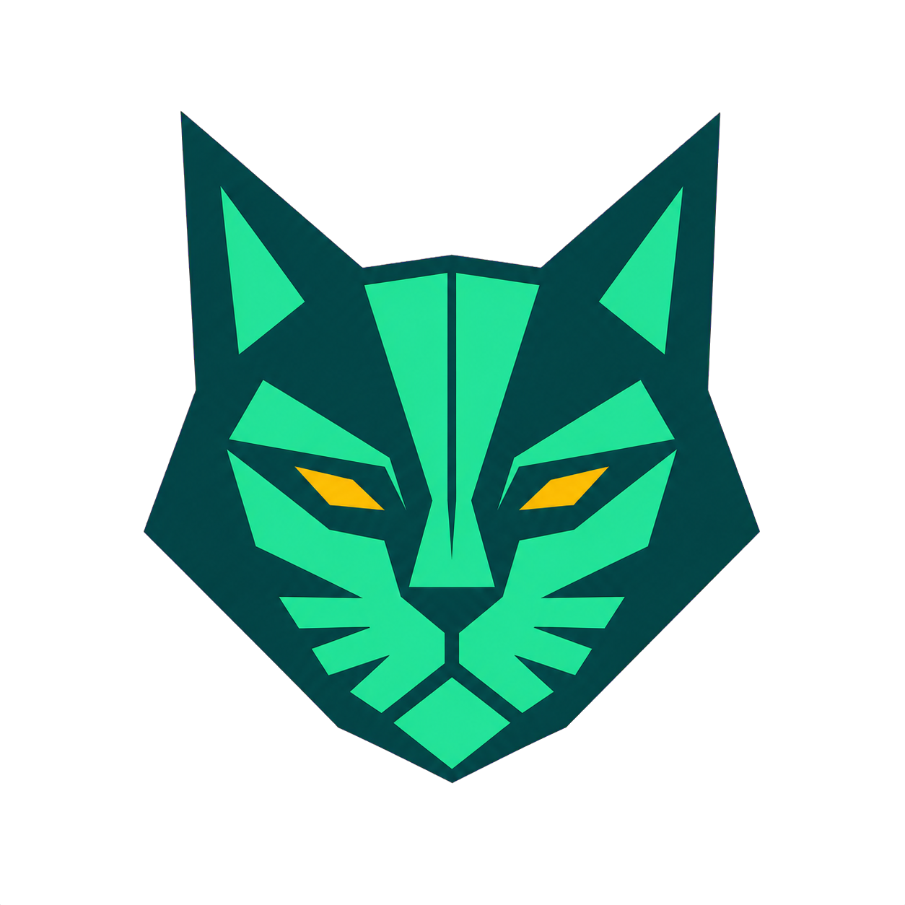

<p align="center">
  
</p>

# CATS — Continuous Assessment & Tracking System

Assess container services, retain the evidence, and manage remediation and security governance in one workspace. CATS combines image inventory, vulnerability and configuration findings, SBOMs, service architecture, approvals, and runtime validation in a shared portal.

**Start here:** [Guided setup](docs/guided-setup.md) · [Deployment templates](templates/README.md) · [Documentation index](docs/README.md) · [Role training](docs/training/README.md) · [Contributing](CONTRIBUTING.md)

## Deploy CATS

Use the [guided main or replica installer](docs/guided-setup.md) for a deployment with HTTPS ingress. It prepares protected settings, checks certificates and local images, configures OCI access, and applies worker isolation where required. Main and replica use the same full CATS image on **Linux amd64**, selected with `CATS_IMAGE`. The replica runs its own portal, OCI proxy, and database without assessment workers or a Docker socket.

From a source checkout, create a small installer bundle:

```sh
python scripts/package-cats-setup.py --mode main --output cats-main-setup
# For a separate replica, use --mode replica and a different output directory.
```

Packaging uses Python's standard library and includes no images by default. Transfer the whole directory to the Linux host with the required CATS, PostgreSQL, and Nginx images already loaded. Follow the [ingress checklist](docs/guided-setup.md#exactly-what-to-ingress), prepare TLS certificates, then run `sudo bash setup-main.sh` or `sudo bash setup-replica.sh` inside the bundle.

| Deployment | Configuration |
| --- | --- |
| Main with HTTPS ingress | [templates/compose.main.yaml](templates/compose.main.yaml) and [main.env.example](templates/main.env.example) |
| Replica with HTTPS ingress | [templates/compose.replica.yaml](templates/compose.replica.yaml) and [replica.env.example](templates/replica.env.example) |
| Local main stack using HTTP | [templates/compose.local.yaml](templates/compose.local.yaml) and [local.env.example](templates/local.env.example) |
| Replica behind your own HTTPS ingress | [templates/compose.replica.external-ingress.yaml](templates/compose.replica.external-ingress.yaml) and [replica.external-ingress.env.example](templates/replica.external-ingress.env.example) |
| Dedicated validator sandbox | [templates/compose.validator.yaml](templates/compose.validator.yaml) and [validator.env.example](templates/validator.env.example) |

See [template instructions](templates/README.md) for exact commands, certificate paths, environment settings, and upgrade procedures. The optional [local Nginx overlay](templates/compose.local-nginx.yaml) adds HTTPS to the local stack. Keep replica and main deployments separate.

### Build from source

With Python and a running Docker engine supporting Linux amd64 builds, run from the repository root:

```sh
python scripts/build-cats-release.py --cats-version 1.3 --tag cats:1.3
```

This builds the scanner base and full CATS runtime, including the React frontend. Select that exact image as `CATS_IMAGE` in the deployment environment. For transfer to a disconnected host, use `docker save --output cats-1.3.tar cats:1.3` and `docker load --input cats-1.3.tar`; the other deployment images must also be available locally. See [offline build requirements](docs/universal-deployment-discovery.md#offline-build-and-operation) and [embedded intelligence](docs/embedded-intelligence.md) for required inputs and readiness timing.

### Local source-checkout deployment

For a new local environment, copy `templates/local.env.example` to `.env`, replace all credential/token placeholders, set a stable encryption key, and select the built `CATS_IMAGE`. Create the configured registry-auth and backup directories; the defaults are `scan-registry-auth` and `backups/postgres` at the repository root. The registry-auth directory may be empty for public registries. Follow the [worker isolation guide](deploy/worker-isolation.md) to qualify the host and enable its AppArmor overlay where required before starting assessment work.

Run from the repository root so existing local paths continue to resolve correctly:

```sh
docker compose --project-directory . --env-file .env -f templates/compose.local.yaml config --quiet
docker compose --project-directory . --env-file .env -f templates/compose.local.yaml up -d --wait
docker compose --project-directory . --env-file .env -f templates/compose.local.yaml ps
```

Open [localhost:8080](http://localhost:8080), or the configured `CATS_PORT`, and sign in with the configured local account. Keep the private control listener on port 8001 inaccessible to clients. Use the HTTPS deployment templates for shared deployments.

**Existing installations:** update the current environment file rather than replacing it. Preserve the database, encryption key, and named volumes, and [back up the database](docs/database-backups.md) before upgrading. Update the selected image and deployment files together and recreate every CATS service, including Discovery and the security-data worker. See [worker upgrades](docs/durable-workers.md#upgrade-an-existing-installation). Removing Compose volumes deletes persistent data.

## What CATS does

| Workflow | Capabilities |
| --- | --- |
| Inventory and discovery | Track versioned services; discover Helm, OCI, Compose, and approved GitLab inputs; review service boundaries before scanning. |
| Assessment and evidence | Scan images and deployment inputs; retain raw findings, SBOM formats, reports, topology, and exportable evidence. |
| Governance | Manage scoped access, POA&Ms, exceptions, mitigations, group-owned risk profiles, and independent Cyber review. |
| Remediation and validation | Plan and patch supported Linux images, rescan candidates, and validate retained Helm artifacts in a dedicated sandbox. |
| Approved releases | Publish signed immutable artifacts and offline bundles; track publication, verification, expiry, and revocation. |
| Distribution | Serve authorized artifacts through the OCI compliance proxy and synchronize retained evidence to a separate replica. |

Scanning, runtime validation, Cyber approval, publication, and signing retain separate outcomes. Missing evidence remains visible; a completed patch or signature alone does not establish deployment readiness. The [training library](docs/training/README.md) provides workflows for administrators, assessors, service managers, and cybersecurity reviewers.

Connected and disconnected operation are supported when the required tools, images, charts, and databases are available. CATS includes signed vulnerability and VEX intelligence; freshness, exact package identity, and publisher applicability constrain its use. Native VEX exclusions are disabled by default. See the [source inventory and licensing](docs/security-data-sources.md) and [VEX deployment guide](docs/native-vex-disposition.md).

## Development

See [CONTRIBUTING.md](CONTRIBUTING.md) for backend setup, frontend commands, targeted checks, repository layout, and branch/review guidance. Docker builds compile frontend assets automatically; direct Python development requires a frontend build and the workers needed for queued operations. Build metadata and image publication are defined in the [GitHub workflow](.github/workflows/build-cats-tool.yml).

Operational guides live in [docs/](docs/README.md). Historical implementation handoffs and qualification evidence are retained for traceability; use the [archive index](docs/archive/README.md) to distinguish older handoffs from current operating instructions.

## License

CATS-authored code and documentation are available under the [MIT License with Commons Clause v1.0](LICENSE). This is a **source-available** license, not an OSI-approved open-source license. It permits use, modification, and redistribution subject to the full license terms, including the restriction on selling products or services whose value derives entirely or substantially from CATS. The restriction also covers qualifying paid hosting, consulting, and support services; ordinary internal use is permitted. See the [Commons Clause terms](https://commonsclause.com/) for the definition of "Sell".

Third-party dependencies, bundled vulnerability/VEX datasets, and other separately licensed material retain their original licenses and notices. See the [included source inventory](docs/security-data-sources.md#included-source-inventory) for the bundled intelligence sources and their terms.

The root `LICENSE` is authoritative. `portal/LICENSE` and `cats-scanner/LICENSE` are identical copies for builds that use those subdirectories as their context; keep them synchronized when changing the license. Application and validator images carry it at `/app/LICENSE`, and the standalone scanner image carries it at `/opt/cats/LICENSE`.
