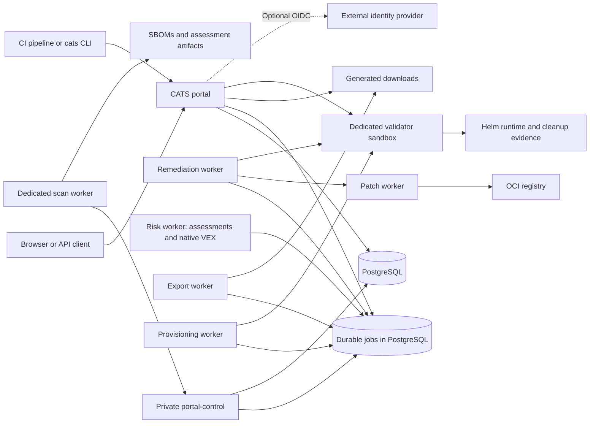

<p align="center">
  
</p>

# CATS — Continuous Assessment & Tracking System

Assess container services, retain the evidence, and manage remediation and security governance in one workspace. CATS brings image inventory, vulnerability and configuration findings, SBOMs, service architecture, approvals, and runtime validation into a shared portal.

The React interface provides service workspaces, scan results, remediation views, and administration. Docker builds compile the frontend automatically, so the UI shipped in an image comes from the checkout used for that build.

## Workspaces and capabilities

| Workspace | Purpose |
| --- | --- |
| Services | Filter the Service Security Matrix; switch Active, Staged, or Archived, choose page size, and inspect versioned service evidence. |
| Jobs | Inspect durable scans, remediation plans/executions, exports, and administrator provisioning operations. |
| Discovery | Upload deployment archives, review a group-owned versioned architecture/image inventory, confirm service boundaries, and explicitly send it to Scan. See the [Discovery guide](docs/universal-deployment-discovery.md) for supported local inputs and native-renderer deployment requirements. |
| Scan | Assess images, Docker image archives, Docker Compose applications, and Helm inputs without creating a persistent service. |
| SBOM | Generate Syft JSON, CycloneDX JSON/XML, and SPDX JSON from a shared inventory. |
| Findings and governance | Review vulnerabilities and configuration issues; manage exceptions, mitigations, POA&Ms, and approvals. |
| Approvals | Request Cyber review of an immutable Current Service or CATS Remediated snapshot, then record an approval or denial with rationale. |
| Approved Releases | Retrieve published, signed artifacts and verified offline bundles; inspect publication failures, retries, and revocation history. |
| Architecture | Explore topology derived from rendered Kubernetes resources and export SVG or workbook data. |
| Patch and Remediations | Patch supported Linux images with Copa, rescan candidates, download artifacts, or publish and optionally sign immutable digests. |
| Deployment Validation | Validate retained Helm artifacts in disposable kind clusters and preserve runtime evidence separately from static assessment. |
| Cybersecurity | Investigate scoped posture, trends, missing evidence, and top service/CVE/package contributors through clickable metrics. |
| Administration | Configure accounts, access, registries, trust, validators, shared signing keys, group policies, and security data sources. |
| Administration → Risk Policy | Create group-owned scoring profiles using labeled controls, preview assessments, save versions, and assign a profile to the owning group. |

Scan downloads include an offline HTML overview, an Excel workbook, SBOMs, raw scanner reports, normalized findings, and a manual DefectDojo import bundle. Connected and disconnected workflows are supported when their required images, charts, databases, and tools are available.

For Cyber approval, choose **Request Cyber Approval** from a service, select the current service or a CATS Remediated candidate, and submit. Missing retained evidence blocks submission; remaining vulnerabilities and absent configuration/Helm coverage are reviewed by Cyber. Administrators configure **Administration → Release Destinations** and global signing under **Settings** before Cyber approves publication. The top-level **Approvals** queue records decisions; **Approved Releases** exposes publication status and retained artifacts. Publication reuses the existing remediation worker and requires no additional Compose service. Cyber approvals expire after 90 days by default (configured for the service's single owning group under **Administration → General Policy**; shared CATS keys are managed under **Settings → Signing**); the signed deadline is preserved in OCI artifacts and offline bundles. Consuming clusters must enforce the signed expiry in their admission policy. See the [Cyber approvals and approved releases guide](docs/cyber-approved-releases.md) for permissions, registry setup, offline import prerequisites, signature trust, and deployment overrides.

## Role training

The [training library](docs/training/README.md) contains real application screenshots and practical guides for every built-in role:

- [Administrator](docs/training/administrator.md): accounts, configuration, validators, signing, and deletion.
- [Assessor](docs/training/assessor.md): evidence review and standard exports.
- [Service Manager](docs/training/service-manager.md): service maintenance, scan ingestion, requests, and remediation.
- [Cybersecurity](docs/training/cybersecurity.md): posture investigation, independent reviews, and security policy.
- [Risk Policy and VEX walkthrough](docs/training/risk-policy-and-vex.md): group-scoped profiles, assessment previews, native disposition, and offline readiness.

All four original role guides and their twelve application screenshots remain available. Screenshots record the October 8 training revision; current navigation and the new risk workflow are explained in the updated text. These guides train operators; the embedded intelligence is security evidence, not a trained machine-learning model.

Assignments can be global, group-scoped, or service-scoped, and permissions combine. The built-in Administrator role excludes `scan.ingest`; an additional suitable grant is needed to retain scans. Temporary public scans are distinct from governed service evidence.

## Install and start

The main stack contains **portal**, **portal-control**, **scan-worker**, **patch-worker**, **remediation-worker**, **risk-worker**, **export-worker**, **provisioning-worker**, **discovery-worker**, and **PostgreSQL**. Portal, its private control listener, and existing workers use the same CATS image. Discovery uses a separate restricted renderer image built by the release script; `--discovery-offline-output <directory>` exports its companion image and sandbox files for disconnected deployment. An optional administrator-managed mirror supplies exact-version, checksum-verified charts and Git/OCI snapshots without public-network fallback. Its approved worker-only sandbox profile is included at `deploy/discovery-seccomp.json`; hosts still require qualification before use. Local accounts are the default; an external OIDC provider is optional. CATS does not deploy Keycloak or another identity provider.

You need Docker Engine or Docker Desktop running Linux containers, Docker Compose v2, and a built CATS image. Run the following from the repository root.

### 1. Configure your environment

For a new installation on Windows:

```powershell
Copy-Item .env.example .env
notepad .env
```

On Linux:

```sh
cp .env.example .env
${EDITOR:-vi} .env
```

Replace the database and bootstrap passwords, pipeline and worker tokens, and encryption-key placeholder. Set `CATS_IMAGE` to your exact image tag. **For an existing installation, update your current environment file instead of replacing it.** Preserve the database volume and encryption key.

Generate the Fernet key using a Python environment with the portal dependencies:

```sh
python -c "from cryptography.fernet import Fernet; print(Fernet.generate_key().decode())"
```

| Setting | Meaning |
| --- | --- |
| `CATS_IMAGE` | Image used by portal, portal-control, and existing workers, for example `cats:1.3`. |
| `CATS_DISCOVERY_IMAGE` | Separate Discovery image built with `Dockerfile.discovery`; defaults to `cats-discovery:local`. See the [build and security requirements](docs/universal-deployment-discovery.md#offline-build-and-operation). |
| `CATS_SCAN_WORKER_TOKEN` | Unique random token of at least 32 characters shared with the private control listener; replace the example placeholder. |
| `CATS_SCAN_REGISTRY_AUTH_SOURCE` | Existing registry-auth directory; defaults to `./scan-registry-auth`. |
| `CATS_PORT` | Browser-facing port; defaults to `8080`. |
| `CATS_BOOTSTRAP_USERNAME` / `CATS_BOOTSTRAP_PASSWORD` | Initial local administrator credentials. |
| `CATS_CONFIG_ENCRYPTION_KEY` | Stable key for stored secrets; retain it across upgrades. |
| `CATS_MANAGED_VALIDATOR_RELEASE_SOURCE` | Optional legacy staged-release directory. Leave blank for automatic preparation when Provision is clicked. |
| `CATS_IDENTITY_MODE` | `local`, `both`, or `oidc`; external OIDC fields start blank. |
| `CATS_DEV_AUTH_BYPASS` | Defaults to `false`; enable only deliberately for isolated development. |
| `SESSION_COOKIE_SECURE` | Set to `true` when serving the portal over HTTPS. |

### 2. Build or load the image

Build from the checkout you intend to deploy. The release command below works from PowerShell or a shell with Python available. Docker must be running. If you use a separate local Windows rebuild shortcut, confirm its checkout and deployed worker list; that shortcut is not included in this repository.

**Connected release build without deployment:**

```sh
python scripts/build-cats-release.py --cats-version 1.3 --tag cats:1.3
```

This builds the unified runtime. HQ prepares the exact validator runtime and pinned Kind dependency when **Provision** is clicked. The optional `--prepare-validator-release` flag exports a legacy staged release; it is not required. See [durable workers and on-demand provisioning](docs/durable-workers.md) for dependencies, resource limits, and upgrade instructions.

**Image transfer to a disconnected host:**

```sh
docker save --output cats-1.3.tar cats:1.3
docker load --input cats-1.3.tar
```

Make PostgreSQL and the pinned Kind node image available in local Docker storage or approved internal repositories. Exporting the CATS image alone does not export the database or runtime volumes. HQ prepares and verifies the validator payload automatically from those inputs. Set `CATS_DEPLOYMENT_KIND_NODE_IMAGE` to override the expected Kind image/version and digest; an optional `CATS_PROVISIONING_NODE_SOURCE` must have the same digest. See [custom Kind pins and service recreation](docs/durable-workers.md#apply-a-custom-kind-pin).

### 3. Start and verify

Before starting, ensure the directory selected by `CATS_SCAN_REGISTRY_AUTH_SOURCE` exists (an empty directory is sufficient without registry credentials). The Windows build utility prepares the default directory. Keep port 8001 private.

If you loaded or built the image without using the Windows deployment utility:

```sh
docker compose config --quiet
docker compose up -d --wait
docker compose ps
```

Open **http://localhost:8080** (or your configured port) and sign in with your local account. The project name is `cats`, so root and main-template deployments refer to the same stack.

```sh
docker compose logs -f portal portal-control scan-worker patch-worker remediation-worker risk-worker export-worker provisioning-worker
```

For upgrades, update the image and Compose file together, select the new `CATS_IMAGE`, and run `docker compose up -d --force-recreate --wait portal portal-control scan-worker patch-worker remediation-worker risk-worker export-worker provisioning-worker`. This preserves named volumes. Keep `validator_payloads`, `validator_data` (managed-validator state/cache), and `export_jobs` (generated downloads). Follow the [worker upgrade guide](docs/durable-workers.md#upgrade-an-existing-installation) if an older installation kept validator state only inside the portal container. `docker compose down` stops the stack; adding `--volumes` deletes persistent data.

The remediation, risk, export, and provisioning workers reuse common Compose settings, wait for portal health, and process jobs stored in PostgreSQL. No message broker or additional published ports are required. Remediation, export, and provisioning progress appears in **Jobs**; completed exports provide a download link there.

Before production use, complete the [scan-worker target-host acceptance checks](docs/dedicated-scan-worker.md). The [architecture review](docs/scan-worker-architecture-review-2026-10-09.md) records measured results, existing test failures, and deployment validation still required. Rebuild the image and update Compose together.

## Risk Policy and native VEX

Each service has exactly one owning group. Under **Administration → Risk Policy**, configuration managers select an authorized group, name a profile, adjust risk-level thresholds and severity scores, and optionally expand evidence/age adjustments and decision labels. Saving creates a new immutable version; assigning is a separate action. Use **Assessments** to preview a draft against a service before assigning it. Profiles inherit from the owning group, then its parents, then the built-in default. Service-only grants do not authorize group profile administration.

Risk scores and human risk decisions are informational: they do not themselves approve publication or alter enforcement. **Native VEX exclusion is a separate, disabled-by-default policy control.** When explicitly enabled, current trusted, exactly applicable Not Affected evidence can remove observations from actionable calculations. Original evidence remains available; stale, ambiguous, conflicting, and unmatched evidence cannot authorize exclusion. Mixed findings remain actionable for their retained observations. Existing POA&Ms and approvals still require human review.

The `risk-worker` handles queued assessments and native VEX evaluations using the same image and persistent database as the portal. Its default limits are 1 CPU and 1 GiB memory (`CATS_RISK_CPUS`, `CATS_RISK_MEMORY`). The bundled signed intelligence snapshot supports disconnected use; it is not a live feed and freshness still matters. First startup imports the corpus before readiness. Compose allows a 60-minute health-check grace period through `CATS_INTELLIGENCE_START_PERIOD`; a successful health check marks readiness immediately. A measured cold import took 43 minutes, but actual time depends on storage and hardware. Allow sufficient startup time in deployment tooling and inspect portal logs.

**Upgrade note:** back up the database and retain the encryption key and volumes. Update the image and Compose together, including `risk-worker`. Legacy unscoped profile and assessment records are retained, but old unscoped/service/default assignments no longer govern current scoring. Recreate reviewed legacy profiles in the intended group and explicitly assign them. Review [native VEX deployment and evidence limits](docs/native-vex-disposition.md) and the [training walkthrough](docs/training/risk-policy-and-vex.md) before enabling exclusions. The real-container audit found no applicable positive VEX match; controlled positive tests do not prove coverage for your images.

## Deployment templates

| Files | Use |
| --- | --- |
| `compose.yaml` + `.env.example` | Repository-root runtime and Windows rebuild utility. |
| `templates/compose.main.yaml` + `templates/main.env.example` | Deployment with an explicitly selected image; staged validator releases are optional. |
| `compose.validator.yml` | Source-built validator on a dedicated Linux amd64 sandbox. |
| `templates/compose.validator.yaml` + `templates/validator.env.example` | Matching validator deployment template and trust settings. |
| `portal/.env.example` | Reference for direct portal development; the root Compose setup uses `.env.example`. |

Follow [template setup](templates/README.md) for commands, file locations, TLS inputs, and the separate validator environment. Real `.env` files and private keys stay outside Git.

## Runtime layout and trust



The patch-worker and isolated provisioning-worker have Docker-host access. The portal has no Docker socket. The scan-worker has no Docker socket or database credentials; it exchanges jobs and evidence through the private control listener. The validator uses host networking and the Docker socket on a dedicated sandbox VM; it must not share a production host. Its validation API uses mTLS, while its administrator interface uses HTTPS. Restrict both interfaces to their intended networks.

Use an HTTPS reverse proxy for shared deployments, keep development bypass disabled, and retain access/audit controls. Configure private registries, trusted CAs, and signing through administration. Signing records the published digest and verification evidence; it does not replace vulnerability or runtime assessment.

Simplified service findings group vulnerabilities by CVE, whereas scan totals may count individual observations. A compliant service remains green when it has warnings; a separate yellow caution indicator explains warning findings on hover. Missing evidence matters even when no vulnerabilities are shown.

Remediation is disabled until enabled in administration. The [remediation wizard](docs/remediation-wizard.md) guides operators through Plan, Review, Confirm, Remediate, Validate, and Deliver. Candidates are retained before delivery; OCI publication requires scoped `artifact.publish` permission and, by default, verified evidence for the exact candidate and service version (`CATS_REMEDIATION_REQUIRE_VALIDATION=true`). Validation, publication, and signing retain separate outcomes. Downloaded candidates are not proof of runtime success; reassess and ingest authoritative evidence after deployment.

Permanent service deletion requires global `service.delete`, a reason, and exact `delete <service name>` confirmation. Active jobs block deletion. CATS removes its service records and associated local outputs, retains audit history, and does not remove external registry images.

Offline operation requires locally supplied inputs and usable scanner databases. Security-source freshness and missing evidence remain part of the assessment. See [cybersecurity and validation](docs/cybersecurity-and-validation.md) and [disconnected delivery limits](docs/schrodinger-deliveries.md).

## Guides

- [Docker Compose ingestion](docs/compose-ingestion.md): ordered files, profiles, previews, image associations, private registries, and limitations.

- [Service remediation](docs/remediation.md) and [remediation pipeline](portal/docs/remediation-pipeline.md)
- [Cyber approvals and approved releases](docs/cyber-approved-releases.md): review, destination setup, signed publication, offline import, and revocation history.
- [Deployment Validation](portal/docs/deployment-validation.md)
- [Durable workers and on-demand provisioning](docs/durable-workers.md): background jobs, resource settings, dependencies, and upgrades.
- [Validator appliance](docs/validator-appliance.md) and [managed validator acceptance](docs/managed-validator-completion-report.md)
- [Signed release documentation](docs/signed-release-documentation.md): immutable OCI attachments, Standard/Offline bundles, verification, and recovery.
- [Signing](portal/SIGNING.md)
- [OIDC integration](docs/KEYCLOAK-INTEGRATION.md)
- [Trusted CAs and repository policies](docs/trusted-ca-and-repository-policies.md)
- [Architecture layout](portal/docs/architecture-layout.md)
- [Standalone scanner](cats-image/STANDALONE-SCAN.md)
- [React frontend development](docs/react-frontend.md)

## Development and checks

Create the backend environment from the repository root:

```powershell
python -m venv .venv
.venv/Scripts/python -m pip install -r portal/requirements.txt -r portal/requirements-dev.txt
$env:PYTHONPATH = "$PWD;$PWD/portal"
.venv/Scripts/python -m pytest portal/tests -q
```

On Linux, use `.venv/bin/python` and `PYTHONPATH=.:portal`. Some integration checks require Docker, Helm, or scanner tools.

For the React frontend, use the tool versions pinned by the Dockerfile and package manifest:

```sh
cd portal/frontend
pnpm install --frozen-lockfile
pnpm typecheck
pnpm test
pnpm build
```

Build frontend assets before launching the Python portal directly; container builds already do so. Direct development also needs the worker processes for queued remediation, export, and provisioning operations. Keep PostgreSQL state, the encryption key, and required release inputs through upgrades, and upgrade portal, portal-control, and all five workers together.


## Embedded Vulnerability and VEX Intelligence Sources

CATS includes a signed, compressed intelligence snapshot in the normal portal and unified application images. Both Dockerfiles verify its Ed25519 signature and payload checksums. At startup, CATS verifies the local package and imports it into PostgreSQL before becoming ready. No external feed, separate intelligence service, or manual first import is required offline. Source links below are provenance references for analysts and connected release builders.

The signature authenticates the CATS release; it does not attest that every upstream document has an independently verified publisher signature. Acquisition uses allowlisted HTTPS sources and pinned input hashes. Original VEX objects and provenance are retained. Only trusted, fresh VEX with exact package, version, distribution and applicable qualifiers can establish applicability. Red Hat and SUSE also require the complete publisher-scoped CSAF containing-product context. A scanner distribution name/version alone cannot prove an enterprise product, module or edition. Versionless, missing, stale, ambiguous and conflicting evidence cannot establish an exact disposition. Supplemental advisories, exploitation evidence and scores never establish Not Affected or rewrite scanner findings, compliance decisions or Cyber approval policy.

Authoritative package identity resolution also uses the installed package database already captured by Syft/Grype. Verified Debian/Ubuntu binary-to-source records preserve namespace, version/epoch, architecture and installed release; derived identities remain separate from the original scanner identity. Debian Source omission semantics follow [Debian policy](https://www.debian.org/doc/debian-policy/ch-controlfields.html#source) and the [captured Syft parser](https://github.com/anchore/syft/blob/v1.31.0/syft/pkg/cataloger/debian/parse_dpkg_db.go). RPM source relationships remain diagnostic until source epoch and publisher product/module/edition context are proved. No additional vendor index, mapping service or redistributed feed is introduced. See the [identity resolution implementation and real-image audit](docs/authoritative-package-identity-resolution.md) for provenance, source licensing, limits and measured coverage.

Refreshes are explicit connected release builds. An unchanged package is verified and skipped; newer sequences import atomically, and older packages cannot downgrade the installed corpus. Failed imports retain the previous committed evidence and report failure in Configuration intelligence settings. Initial import delays readiness; plan deployment timeouts and storage using the [measured release results](docs/embedded-intelligence.md#measured-release-results). Freshness uses original publication and acquisition dates, never deployment time. Existing administrator trust settings and historical assessments are preserved.

Native VEX effective disposition is available under **Administration → General Policy** and is **disabled by default**, including upgrades. When enabled, only current verified Not Affected observations leave actionable calculations; original scanner evidence and human decisions remain intact. Services/Raw Findings expose exclusion evidence, and **Administration → Risk Policy** contains group-scoped profiles and assessment review. The existing `risk-worker` must run, including offline deployments. See [native VEX lifecycle, deployment and evidence limits](docs/native-vex-disposition.md); controlled positive tests do not close the real-image applicability gap.

### Included source inventory

The signed snapshot includes **three VEX publishers and ten supplemental datasets from nine publishers: 13 sources**. CISA supplies two supplemental datasets; SUSE supplies VEX and separate recommendations. Counts below are actual selected documents or CVE-linked records from the final manifest, not entire upstream corpus sizes or counts of currently usable matches. Whole VEX documents are retained within the stated bounds; individual statements are never truncated.

| Source, authority and product scope | Format and selected coverage | Included | Data license and conditions |
| --- | --- | ---: | --- |
| [Canonical Ubuntu VEX](https://documentation.ubuntu.com/security/security-updates/vex/): Ubuntu vendor; `pkg:deb/ubuntu/`. | [OpenVEX archive](https://security-metadata.canonical.com/vex/vex-all.tar.xz); 50,747 CVE-primary and 7,297 USN-primary documents with explicit verified CVE aliases; 512 KiB and 10,000 expanded statements per document. | 58,044 documents; 23,252,990 normalized statements. | [CC-BY-SA-4.0](https://github.com/canonical/ubuntu-security-notices/blob/main/LICENSE): attribution and share-alike obligations for covered data/adaptations; license bundled. |
| [Red Hat VEX](https://access.redhat.com/security/data): vendor authority within `pkg:rpm/redhat/` and exact containing-product context. | [CSAF JSON per-CVE archive](https://security.access.redhat.com/data/csaf/v2/vex/); complete selected documents up to 256 KiB. The separate newer binary-RPM feed is excluded. | 59,417 documents; 5,589,493 normalized statements, including 1,481,906 with versioned PURLs. | [CC-BY-4.0 security-data grant](https://access.redhat.com/security/data): Red Hat attribution and original links; legal text and notices bundled. |
| [SUSE VEX](https://www.suse.com/support/security/csaf/): vendor authority within `pkg:rpm/suse/` and exact containing-product context. | [CSAF 2.0 JSON](https://ftp.suse.com/pub/projects/security/csaf-vex/); bounded cohort of 2,048 newest indexed, available documents; 1 MiB canonical cap excludes 122. | 1,926 documents; 370,464 normalized statements, including 6,490 with versioned PURLs. | [CC-BY-4.0 data grant](https://www.suse.com/support/security/csaf/): required per-document notice verified; SUSE attribution, original objects and legal text retained. |
| [CISA KEV](https://www.cisa.gov/known-exploited-vulnerabilities-catalog): US cybersecurity agency; cross-ecosystem exploitation evidence. | Catalog JSON; entire acquired catalog. Absence does not establish lack of exploitation. | 1,748 exploitation records. | [CC0-1.0](https://github.com/cisagov/kev-data/blob/develop/LICENSE); notice bundled. |
| [Alpine SecDB](https://secdb.alpinelinux.org/): distribution-maintained package-fix advisories. | SecDB JSON; v3.24 main/community. Older releases and non-CVE identifiers excluded; a published fix does not prove the installed package is patched. | 10,094 advisory records. | [CC-BY-SA-4.0](https://secdb.alpinelinux.org/license.txt): attribution and share-alike obligations for covered data/adaptations; license bundled. |
| [GitHub Advisory Database](https://github.com/github/advisory-database): reviewed cross-ecosystem advisory aggregation. | OSV JSON; reviewed entries with CVE aliases, retaining affected ranges. Unreviewed and non-CVE-only entries excluded. | 32,256 advisory records. | [CC-BY-4.0](https://github.com/github/advisory-database/blob/main/LICENSE.md): attribution/license bundled. |
| [SUSE recommendations](https://www.suse.com/support/security/csaf/): vendor product recommendations from the selected SUSE cohort. | CSAF `recommended` identities retained with exact product context. Recommended is not fixed; these records do not determine installed-product applicability. | 1,576 advisory records. | [CC-BY-4.0 data grant](https://www.suse.com/support/security/csaf/): same SUSE notices, attribution and license as its VEX data. |
| [FIRST EPSS](https://www.first.org/epss/data): cross-CVE predictive risk scores. | Daily CSV; entire acquired score snapshot with score dates and percentiles. Probability is not confirmed exploitation or product applicability. | 391,411 risk-enrichment records. | [FIRST data-use terms](https://www.first.org/epss/faq), recorded as `LicenseRef-FIRST-EPSS`: free product use permitted, attribution requested; terms bundled. No SPDX license inferred from example code. |
| [NIST NVD](https://nvd.nist.gov/vuln/data-feeds): cross-product vulnerability reference data. | CVE JSON 2.0; rolling modified feed only, retaining CVSS, CPE configurations and references. Not full historical NVD or vendor VEX. | 22,272 vulnerability records. | [NIST public-service terms](https://www.nist.gov/open/license), recorded as `LicenseRef-NIST-Public-Service`: copying/modification/distribution with acknowledgments and disclaimer; full terms bundled. |
| [CISA Vulnrichment](https://github.com/cisagov/vulnrichment): CISA analysis and SSVC enrichment. | CVE JSON 5 ADP containers authored by CISA only; surrounding CNA/other ADP content excluded. SSVC exploitation `none` is not negative exploitation evidence. | 200,751 risk-enrichment records. | [CC0-1.0](https://github.com/cisagov/vulnrichment/blob/develop/LICENSE), scoped to the retained CISA-authored material; notice bundled. |
| [Go vulnerability database](https://github.com/golang/vulndb), distributed via OSV: Go ecosystem advisory maintainers. | OSV JSON; only `GO-` entries with CVE aliases from the Go dump; affected ranges preserved. Other publishers excluded. | 4,428 advisory records. | [CC-BY-4.0 data license](https://github.com/golang/vulndb/blob/master/data/LICENSE): attribution/license bundled; separate code license does not apply to this data. |
| [PyPA advisory database](https://github.com/pypa/advisory-database), distributed via OSV: Python ecosystem advisory maintainers. | OSV JSON; only `PYSEC-` entries with CVE aliases from the PyPI dump; affected ranges preserved. Other publishers excluded. | 7,667 advisory records. | [CC-BY-4.0](https://github.com/pypa/advisory-database/blob/main/LICENSE): attribution/license bundled. |
| [RustSec](https://github.com/rustsec/advisory-db), distributed via OSV: Rust ecosystem advisory maintainers. | OSV JSON; only `RUSTSEC-` entries with CVE aliases from the crates.io dump; affected ranges preserved. Other publishers excluded. | 607 advisory records. | [CC0 plus CC-BY-4.0 for imported GitHub content](https://github.com/rustsec/advisory-db/blob/main/LICENSE.txt): both texts, attribution and original references retained. |

Source terms apply to the corresponding data and adaptations; there is no common license over all 13 sources, and inclusion does not imply publisher endorsement. The [signed manifest](portal/app/embedded_intelligence_data/manifest.json) records exact counts, hashes, acquisition dates and exclusions. Source freshness defaults are seven days for EPSS and 30 days for the other sources; individual VEX evidence must also pass publication-age checks. Normalized statement totals include overlapping evidence and rows lacking the version/context needed for a current match. The [read-only evidence API](docs/supplemental-evidence-api.md) exposes supplemental retained history with provenance and explicitly unevaluated current membership/applicability.

All selected release downloads use public HTTPS without API credentials. The [access-path and request-limit review](docs/supplemental-source-research.md#access-paths-and-request-limit-evidence) lists the bulk or indexed route for every included source and distinguishes observed access from unestablished numeric quotas. SUSE uses bounded concurrent individual downloads; other inputs use static archives or snapshots. The application performs no feed polling.

### Deferred sources and inclusion criteria

Public access and software-code licensing alone do not establish permission to redistribute security data. Inclusion requires reviewed data terms, bounded acquisition and parsing, and preserved identities; product applicability additionally requires a reviewed exact identity mapping.

- **Microsoft MSRC:** its [CVRF API](https://github.com/microsoft/MSRC-Microsoft-Security-Updates-API) and [Azure Linux CSAF VEX](https://www.microsoft.com/en-us/msrc/blog/2025/10/toward-greater-transparency-machine-readable-vulnerability-exploitability-xchange-for-azure-linux) are available. A feed-specific redistribution grant has not been established under the reviewed [terms](https://www.microsoft.com/en-us/legal/terms-of-use), and an exact product-ID mapping adapter is not implemented. This is not a claim that Microsoft has no VEX feed.
- **Chainguard/Wolfi:** current OSV/SecDB feeds have [data-specific terms](https://github.com/chainguard-dev/vulnerability-scanner-support/blob/main/docs/foundational_concepts.md), including CC-BY-NC-ND-4.0 or the [conditional commercial-scanner license](https://www.chainguard.dev/legal/chainguard-license-for-commercial-scanners). Eligibility and downstream redistribution rights for this bundle are not established; exact component/architecture mapping also needs review. Chainguard also publishes a separate current [Libraries OpenVEX feed](https://libraries.cgr.dev/openvex/v1/); this review has not established a redistribution grant for that VEX data, and does not assume the OSV terms cover it. Exact `+cgr` identities and origin must be preserved. An archived Wolfi feed cannot represent current coverage.
- **Debian Security Tracker:** its [JSON export](https://security-tracker.debian.org/tracker/data/json) is technically feasible, but this review found no explicit tracker-data redistribution grant; the distinction is also raised in [Debian's own mailing list](https://lists.debian.org/debian-security-tracker/2026/09/msg00023.html). Source-package/release status would require verified source-to-binary mapping before any installed-package applicability claim. No Debian data is substituted through OSV.

See the [expanded release acceptance report](docs/embedded-intelligence-expanded-report.md), [release procedure and offline measurements](docs/embedded-intelligence.md), [Red Hat evidence](docs/redhat-csaf-evidence.md), [SUSE/MSRC/Chainguard research](docs/vendor-source-research.md) and [supplemental-source research](docs/supplemental-source-research.md) for complete acquisition bounds, licensing evidence and exclusion decisions.

Discovery supports additional Flux chart references, native Kustomization transformations, opt-in checksum-pinned HTTPS artifact mirrors, and optional encrypted render reuse during retries. Configuration and remaining limitations are documented in [Universal deployment discovery](docs/universal-deployment-discovery.md#follow-up-flux-sources-approved-retrieval-and-render-reuse).

Discovery can accept missing non-secret files after initial review and create a new inventory with parent/file provenance. Optional encrypted caching reuses unchanged native renders and approved dependency artifacts. See the [local acceptance report](docs/discovery-local-acceptance-2026-10-20.md) for deployed-worker verification and remaining limits.
