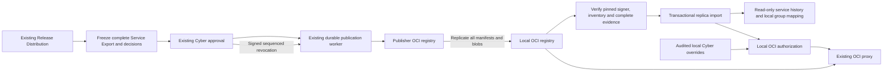

# Portable approved releases

Portable publication extends the existing Release Distributions, Cyber approval, Export All and approved-release worker. A distribution selects deployment artifacts; the frozen review includes the complete service evidence and identifies that selection. The ordinary Service Import workflow continues to import inputs for reassessment. Only a verified, independently trusted approved release can enter the replica evidence path.

## What is signed

The existing `cats-cyber-approved-release-v1` manifest has a `portable` object with format `cats-replica-release-v1`, publisher-scoped service UUID (the existing service key), release UUID (the existing approval ID), positive monotonic service sequence, superseded release UUID, service version, Cyber approval time, expiration, and revocation state. The manifest includes the recorded approver, decision time and rationale, publisher public-key fingerprint, exact image and chart digest inventory, detached evidence signature, and each artifact's immutable Cosign signature manifest digest. Sequence reservation occurs atomically with the Cyber decision. Retries reuse the approved identity and sequence.

`evidence.zip` includes the existing Export All material and `replica-service.json` (`cats-replica-service-v1`). The capture uses Service Export's relational schema, ownership checks and credential redaction while retaining findings, observations, SBOM, mitigations, exceptions, remediation and scan history, approval context, risk assessments and decisions, referenced VEX documents, artifact provenance and the authoritative dashboard outputs. Distribution and proposal evidence include a separately labeled complete service-context Export All archive. Candidate evidence retains its baseline and proposed scope explicitly. Source accounts are retained as identity evidence, never copied as local accounts or permissions. Local paths and credentials are excluded.

An approval created before complete capture support must be submitted for Cyber review again. Publication fails with that instruction instead of reconstructing mutable current evidence for an old decision.

The capture records canonical finding classifications and final eligibility, noncompliance, exception, VEX, KEV and EPSS decisions, plus observation exclusions, at the same capture time. It does not depend on a previously refreshed classification cache. An explicit allowlist retains the source policy configuration; authentication, registry and other runtime configuration are excluded. The replica uses these frozen results for evidence views rather than reassessing them under local policy.



## Registry layout and replication

For destination namespace `cyber-approved` and service key `demo`:

| Repository | Content |
| --- | --- |
| `cyber-approved/demo/<image>` | Images or image indexes, all child manifests and layers, approval tags and Cosign signature artifacts |
| `cyber-approved/demo/charts/<chart>` | Exact Helm package, config and Cosign signature artifacts |
| `cyber-approved/demo/releases` | Portable release documents and standalone signed revocation events |

The portable document artifact has media type `application/vnd.oci.image.manifest.v1+json` and artifact type `application/vnd.cats.approved-release.v1`. Its layers directly reference the signed manifest, signatures, public key, complete evidence archive and candidate archive when applicable. This explicit OCI artifact is the compatibility path: replica verification does not rely on referrer discovery or implicit Harbor attachment behavior. The signed inventory explicitly identifies artifact and signature graphs by digest.

Discovery tags are `release-<20-digit-sequence>-<release-id>` and `revocation-<20-digit-sequence>-<release-id>`. They are published only after the entire graph is verified. Tags are hints; the signed sequence and digest are authoritative. Do not retag existing releases as new approvals.

Replicate the complete service repository subtree, including charts, the `releases` repository, image index children and all Cosign signature artifacts. A filter selecting only image approval tags is insufficient. Harbor documents filtered image/chart replication and associated Cosign signature replication, but also warns about unsupported cross-version combinations; qualify the exact Harbor versions and rule before deployment. [Harbor replication documentation](https://goharbor.io/docs/main/administration/configuring-replication/)

Configure an exact repository such as `cyber-approved/demo/releases`, or `cyber-approved/*` to discover descendant release repositories. Exact repositories use paginated `/tags/list`; wildcard scopes also require the registry's paginated `/v2/_catalog`. If catalog listing is unsupported or unauthorized, configure exact repositories. Pagination follows same-origin, same-endpoint `Link: rel="next"` values and rejects cycles and redirects to another repository. There is no first-page or fixed artifact-count shortcut. [OCI Distribution specification](https://github.com/opencontainers/distribution-spec/blob/main/spec.md)

Default replication preserves repository paths and replaces the registry host. A configured namespace mapping can replace the signed source namespace; every fetch still targets the configured local registry. Registry TLS trust and read credentials are local configuration, independent of the publisher signing trust.

## Verification and revocation

Provision the publisher fingerprint independently. A key embedded in a package never grants its own trust. The replica verifies the detached signed manifest before using its sequence or identities, checks exact evidence digests and signatures, validates archive inventory, retrieves every artifact/index child/config/layer, and verifies each explicitly referenced Cosign signature against the pinned publisher and the signed approval times. Missing, corrupt, untrusted or mismatched content cannot produce a complete verified candidate. Storage limits bound bytes, archive expansion and nesting without silently truncating inventories.

Revoking a portable approval queues a standalone signed event through the same durable worker and `releases` repository. It names the exact target release, next sequence, revoker, timestamp and rationale. It does not modify the original signed approval. Failed revocation publication remains visible and can be retried with its original sequence. The original publisher signing identity and approved destination must remain available to publish the event.

Registry replication may deliver objects out of order. Verification failure leaves the existing valid active release available; later sync can retry once all content arrives. Expiration is never extended by copying, importing or retrying. An expired correctly signed package may be retained as historical evidence; active pull authorization applies expiry, revocation and explicit local override policy independently. A disconnected replica can enforce only revocations it has received and verified. Use scheduled sync and a trusted UTC clock.

## Upgrade and compatibility

`CATS_MODE` defaults to `full`, preserving the existing authoring deployment. Replica mode uses the separate `compose.replica.yaml` deployment and database. Back up the database and retained release storage before upgrading. The existing startup schema initialization adds the publication sequence, replica projection, identity mapping and local override tables; no existing approval is rewritten or assigned a fabricated signed sequence.

Existing Service Export and ordinary Service Import remain available in full mode. Ordinary imports still require local reassessment. Historical approvals and their retained bundles remain reviewable. An unpublished or retried legacy approval lacking `replica-service.json` cannot become a portable release: submit a new Cyber request and review its complete frozen evidence. Existing OCI proxy authorization remains the full-mode path; replica authorization uses verified imported inventory and explicit local mappings. Retain publisher keys, approved destination configuration and signed receipts for retry and revocation. Key rotation requires independently provisioning the new fingerprint before its releases can be accepted.

## Qualifying a Harbor deployment

Harbor must be qualified with its own replication engine, separately from the OCI Distribution copy check below. Repeat these checks for the exact source and target versions, adapter and rules intended for deployment:

1. Use disposable source and target projects on TLS-protected Harbor instances. Record both Harbor versions, adapter type, certificates, robot scopes, retention rules and whether catalog listing is permitted. Pin the publisher fingerprint independently in the replica.
2. Publish a new approved service containing an image index with at least two architectures, a Helm chart, complete findings/SBOM evidence and signed decisions. Save the published document digest, artifact/signature digests, release identity, sequence and validity dates.
3. Configure a replication rule covering the complete service repository subtree, including `/releases`, `/charts/`, every index child, blobs and signature artifacts. Run it and retain its task logs. Ensure retention and tag filters do not discard document artifacts or signature manifests.
4. Configure the replica against the target registry only. Use exact `/releases` repositories if catalog listing is unavailable, otherwise exercise wildcard discovery and pagination. Map the imported service to a local group and confirm complete evidence and every architecture/chart are available through authorized local routes.
5. Disable access to both source CATS and source Harbor. Repeat discovery, verification, evidence views and authorized local pulls. Compare the retained signed document and evidence digests with step 2. No original host may be needed.
6. In a disposable target copy, omit one child manifest, layer, evidence document or explicitly referenced signature manifest and repeat sync. Each incomplete candidate must fail verification without replacing the valid active release. Test an untrusted publisher and a changed signed sequence as well.
7. Publish and replicate a newer approval, replay the older package, then publish a standalone revocation. Verify monotonic selection, unchanged original expiry, exact target revocation and restart persistence. Repeat with an interrupted replication task and retry after all objects arrive. Retain logs and results as deployment qualification evidence.

If Harbor does not copy the complete explicitly referenced artifact graphs with the selected rule, the rule is not qualified. Use a compatible replication configuration or an OCI copy process that follows every referenced digest; do not relax signature or completeness checks.

### Completed Harbor qualification

The [2026-11-05 Harbor acceptance record](harbor-replication-acceptance-2026-11-05.json) qualifies the isolated source/target pair running Harbor `v2.15.4-d8841742`, its `harbor` adapter, TLS trust and complete-subtree rules. The actual Harbor jobservice replicated the unchanged signed receipts from the completed real nginx scan/patch workflow below. This qualification reused approvals 2 and 3; it did not fabricate or repeat their assessments.

With all source Harbor and original CATS services stopped, a fresh PostgreSQL replica imported the successor and completed its first 63,708,030-byte patched-image pull from target Harbor. The successor cache was independently empty beforehand. Both signed evidence archives matched the originals. A service-scoped Local Cyber account created an indefinite exact-digest override, its old-image pull generated 10 matching usage records, and revocation denied the next request despite cached content. Administrator-only creation and an unrelated digest were denied. Restart preserved the revoked override, denied the old image and allowed the successor.

Separately labeled synthetic releases verified both image architectures, a Helm chart, signed findings/SBOM evidence, replay protection, preserved expiry and standalone revocation through the production verifier/importer with an isolated SQLite ledger. Four actual target omissions preserved the active baseline and all four restored graphs recovered using their retained ledgers. Missing child/signature manifests returned 404; missing layer/evidence blobs returned 200 with empty bodies, which production integrity checks rejected. Restored hashes were verified and no quarantine files remained. Wrong-signer and changed-sequence checks also passed. Harbor execution 8 stopped an active fresh-layer transfer; retry 9 succeeded, and its complete graph was verified after source shutdown. Earlier preflight failures and transfers that completed before cancellation remain recorded and are not counted as interruptions.

Both public projects used scoped one-day robots and had no retention configured. Anonymous and scoped-robot catalog access returned 401, so the qualified replica uses exact release repositories. All 21 qualification services were stopped afterward, retaining private evidence and volumes. The controller's 25 focused tests passed. These results apply to this pair and configuration; repeat qualification for the intended production versions and rules.

### Repeating the isolated Harbor qualification

The opt-in drivers use a dedicated private workspace and disposable Harbor projects. Keep the workspace outside the repository: it contains temporary robot credentials, signing keys, database state, logs and retained receipts. Use the pinned local images in `tests/harbor/images.lock.json`, Docker Compose, and Python with requests, PyYAML and cryptography. The stack helper verifies the official installer checksum and starts separate source and target Harbor instances; its default action only prints a plan.

| Driver | Responsibility |
| --- | --- |
| `portal/tests/harbor_acceptance_stack.py` | Provision the isolated TLS Harbor pair and retain its ownership record; scoped cleanup retains volumes by default |
| `portal/tests/harbor_replication_qualification.py` | Configure scoped robots and complete-subtree Harbor rules, seed source-only content, run and retain actual replication executions, and verify the recovered transfer graph |
| `portal/tests/harbor_nginx_qualification.py` | Create a fresh three-service replica from the completed real nginx acceptance, verify disconnected pulls and override enforcement, and check persistence after restart |
| `portal/tests/harbor_graph_qualification.py` | Publish clearly labeled synthetic multiarchitecture/Helm releases, verify signed evidence and monotonic events, and inject reversible omissions into the disposable target |

Provision with `harbor_acceptance_stack.py --repo <repository> --workspace <private-workspace> --provision`, then run `harbor_replication_qualification.py setup --workspace <private-workspace>`. Preserve the completed nginx acceptance's Docker network and locally built replica image as well as its workspace: the fresh replica reads these from the retained Compose definition and joins that external network for publisher-disconnection probes. The generated `harbor-stack.json` records the Harbor bridge network, Compose file and service names. Host-side controller commands use authenticated HTTPS and the generated CA. The registered destination uses the `harbor` adapter with TLS verification enabled. Projects are public for anonymous replica pulls; publishing and replication use one-day robots scoped to the two disposable projects. The rules preserve repository paths and include all tags, signatures and the release repository. Do not add image-only tag filters or retention that removes referenced objects.

Run the source publication and graph-verification phases in a CATS image on the generated bridge network. Mount this checkout read-only at `/source`, the private workspace at `/verification`, set `PYTHONPATH=/source/portal`, `SSL_CERT_FILE=/verification/tls/ca-bundle.crt`, and `DOCKER_CONFIG=/verification/docker`. For source seeding, also mount the completed real nginx acceptance read-only, make its publisher registry reachable, and include that registry's CA in the trusted bundle. The `seed` command copies the original signed receipt graphs into source Harbor only and preserves their immutable identities; it does not rescan nginx or create new approvals.

1. Run controller `seed --label source`, supplying the original workspace and source registry host. Publish the synthetic graph with the graph driver's `publish` phase in its own workspace. This fixture exercises two architectures, a Helm package, findings, SBOMs and signed decisions; it is not a real Cyber assessment. Leave the patched nginx receipt out of source Harbor until the fresh replica has pulled the original approval.
2. Run controller `replicate --namespace approved` and `replicate --namespace qualification`. Retain every execution and task log, including unsuccessful attempts. Target content must arrive through Harbor's jobservice, not the seed helper.
3. Prepare the fresh nginx replica with `--phase prepare --workspace <private-workspace>/replica --original-workspace <completed-nginx-workspace> --network <bridge> --ca-file <ca.crt> --ca-bundle <ca-bundle.crt>`. Run `up`, `setup`, `online-proof` and `sync-source`. Retain the online TLS probes and complete original-image pull. Seeding both nginx approvals before this step would supersede the original too early and fail the required baseline check.
4. Now run controller `seed --label patched`, then `replicate --namespace approved` again. Exercise an actual interrupted transfer separately: publish a fresh `transfer-probe`, run `replicate --namespace interruption --interrupt-after 5`, then rerun without interruption. Cancellation must leave a nonempty incomplete task; a preflight outage or an already completed job does not qualify. The probe is a labeled synthetic 32 MiB OCI layer. A stopped execution may take time to release its transfer worker; wait for the retry to complete.
5. Stop every source Harbor service named in `harbor-stack.json`, the original publisher registry and full CATS. Record their stopped states. Leave target Harbor and the fresh replica running. Run controller `verify-probe --harbor-host harbor-target.test:8443` to verify every recovered byte, then nginx phases `sync-patched`, `verify` and `restart-check`. The driver requires connection failures to the sources, a working target, zero cached successor manifests/links and absent successor-only blobs before its first pull. It then verifies signed evidence, complete pulls, administrator/Cyber separation, an indefinite exact-release override, usage auditing, unrelated-digest denial, immediate revocation despite cached content, and restart persistence.
6. With the source still stopped, run graph `verify --case complete`, `wrong-signer` and `changed-sequence`. For each of `missing-child`, `missing-layer`, `missing-evidence` and `missing-signature`, use `quarantine`, verify that case, `restore`, then `verify --case recover --failed-case <case>`. Quarantine/restore require both the exact disposable target volume mounted at `--registry-storage` and `--confirm-target https://harbor-target.test:8443`. Always restore in a finally/cleanup path. Each omission must prove unavailable or corrupt target content while its parent remains available, fail production verification without replacing the valid baseline, and recover using the same retained ledger. Record the HTTP status and returned byte count/hash: this Harbor version can return HTTP 200 with an empty body for a missing blob, which must still fail integrity verification. Storage restoration tests candidate retry; the separate interrupted execution tests Harbor's replication retry.

Use the controller's read-only `inspect` phase before stopping the source to retain actual policies, robot permissions, retention and scoped repository inventories. Separately record `/v2/_catalog` access with the configured replica identity. Exact release repositories are supported when catalog listing is unavailable. Keep the raw private evidence, but publish only a sanitized summary. Stop only these script-owned stacks after verification; do not prune Docker resources. `harbor_acceptance_stack.py --cleanup` requires the ownership record, and `--remove-volumes` is an explicit additional operation. Stop/remove the dedicated replica before removing its external Harbor bridge.

## Repeating the real OCI registry check

`portal/tests/portable_registry_integration.py` uses synthetic relational evidence and real HTTPS registries, real Cosign signing/verification, image indexes and Helm packages. It copies immutable signature manifests explicitly while omitting mutable Cosign tags/referrers, then verifies the replica after stopping the publisher. It also rejects an untrusted signer and a deleted architecture child. It does not test Harbor itself or manufacture a production Cyber review.

The following PowerShell example starts only an isolated internal network and disposable containers, without public registry ports. Run from the repository root with Docker available. Build the full publisher and lightweight replica test images, or substitute existing images built from the corresponding Dockerfiles with their pinned Cosign version. The verification phase uses the code baked into the replica image. Use a new workspace and name prefix for each run.

```powershell
$repository = (Get-Location).Path
$testRoot = Join-Path $env:TEMP ('cats-portable-' + [guid]::NewGuid().ToString('N'))
$testPrefix = 'cats-portable-' + [guid]::NewGuid().ToString('N').Substring(0, 10)
$testImage = 'cats-portable-test:local'
$replicaImage = 'cats-portable-replica-test:local'
New-Item -ItemType Directory -Path $testRoot | Out-Null
docker build -t $testImage -f portal/Dockerfile portal
docker build -t $replicaImage -f portal/Dockerfile.replica portal
$mounts = @('--mount', "type=bind,source=$repository,target=/workspace,readonly",
            '--mount', "type=bind,source=$testRoot,target=/verification")
$runner = @('--rm', '--entrypoint', 'python', '-e', 'PYTHONPATH=/workspace/portal',
            '-e', 'PYTHONDONTWRITEBYTECODE=1')
docker run @runner @mounts $testImage /workspace/portal/tests/portable_registry_integration.py tls /verification
docker network create --internal "$testPrefix-network"
try {
    foreach ($side in @('publisher', 'replica')) {
        docker run -d --name "$testPrefix-$side" --network "$testPrefix-network" `
            --network-alias "$side.test" --mount "type=bind,source=$testRoot,target=/verification,readonly" `
            -e REGISTRY_HTTP_ADDR=0.0.0.0:5000 `
            -e REGISTRY_HTTP_TLS_CERTIFICATE=/verification/tls/registry.crt `
            -e REGISTRY_HTTP_TLS_KEY=/verification/tls/registry.key `
            -e REGISTRY_STORAGE_DELETE_ENABLED=true registry:2.8.3
    }
    docker run @runner @mounts --network "$testPrefix-network" $testImage `
        /workspace/portal/tests/portable_registry_integration.py publish /verification
    if ($LASTEXITCODE -ne 0) { throw 'Publication/copy phase failed' }
    docker stop "$testPrefix-publisher"
    docker run --rm --entrypoint python -e PYTHONPATH=/app -e CATS_MODE=replica `
        -e PYTHONDONTWRITEBYTECODE=1 @mounts --network "$testPrefix-network" $replicaImage `
        /workspace/portal/tests/portable_registry_integration.py verify /verification
    if ($LASTEXITCODE -ne 0) { throw 'Replica verification phase failed' }
} finally {
    docker rm -f "$testPrefix-publisher" "$testPrefix-replica"
    docker network rm "$testPrefix-network"
}
```

Each successful phase emits a compact JSON result. The successful implementation check used `registry:2.8.3` and Cosign `v2.6.1`; its final verification ran in the lightweight replica image with `CATS_MODE=replica` and the publisher stopped. It verified both image architectures and one Helm chart, preserved the exact digest on retry, and passed the disconnected-source, immutable-signature fallback, standalone revocation, wrong-key and missing-child checks. This synthetic release test does not validate a real scanned/patched nginx approval workflow or Harbor replication. The temporary workspace contains only synthetic test data and ephemeral signing/TLS keys; retain it for inspection or remove that explicitly named workspace after review.

## Repeating the real nginx acceptance workflow

This procedure uses actual Discovery, scanner, patch, approval, publication and replica APIs. The [2026-11-05 acceptance record](real-nginx-acceptance-2026-11-05.json) records a completed run with `nginx:1.28.0-alpine3.21` on linux/amd64. The three drivers are `nginx_workflow_integration.py` (System A), `nginx_replica_acceptance.py` (exact receipt copying and verification helpers), and `nginx_replica_workflow.py` (System B); `nginx_acceptance_stack.py` provisions their isolated environment. Copying between the two `registry:2.8.3` Distribution registries exercises OCI transport. The separate completed Harbor qualification above reused these signed approvals with Harbor's own replication engine.

The run scanned and published approval 2, completely pulled its original image through the replica, and patched the same immutable source. The patch scanner reported 194 fixable vulnerability findings before patching and 0 afterward. A fresh scan of that exact output produced successor approval 3. Both image and release signatures were verified. Failed scan, approval and patch attempts remain in the private runtime history.

After copying the successor, all System A services and its registry were stopped. System B imported the successor and downloaded its complete 63,708,030-byte image graph. Independent checks recorded zero cached manifest rows and object links for the patched root before that first pull, then one manifest and 14 links afterward. The publisher registry returned HTTP 200 before shutdown and a connection failure from the replica afterward. The old root was denied, an Administrator-only account was denied override creation, and a service-scoped Local Cyber account created an indefinite exact-digest override. Its complete old-image pull generated 10 matching usage records. Revocation restored denial on the next request despite the warm cache; the successor remained accessible. Both evidence archives matched their signed hashes and read-only contexts. An unapproved release-document root also remained denied; that check does not claim coverage of a second superseded image.

Run the following PowerShell commands from the repository root with Docker Compose and a host Python environment containing `requests`. Choose an existing scanner base image and a populated, current Trivy database volume; the example assumes Grype's real database is already in the scanner image. Add `--grype-source-volume` if Grype also needs a source volume. Source volumes are mounted read-only for copying into dedicated project volumes. A database check rejects missing scanner data.

```powershell
$repository = (Get-Location).Path
$testRoot = Join-Path $env:TEMP ('cats-nginx-' + [guid]::NewGuid().ToString('N'))
$project = 'cats-nginx-' + [guid]::NewGuid().ToString('N').Substring(0, 10)
$python = 'python' # Or the repository virtual environment's Python executable.
$fullImage = "${project}-full:local"
$replicaImage = "${project}-replica:local"
$scannerBase = 'catscan-base:local' # Replace with the available scanner base.
$trivyCache = 'existing-fresh-trivy-cache' # Replace with a populated volume.
function Invoke-NginxStep {
    & $python @args
    if ($LASTEXITCODE -ne 0) { throw 'Acceptance step failed; retain the workspace.' }
}
$provision = @('portal/tests/nginx_acceptance_stack.py', '--repo', $repository,
    '--workspace', $testRoot, '--project', $project, '--full-image', $fullImage,
    '--replica-image', $replicaImage, '--scanner-base', $scannerBase,
    '--trivy-source-volume', $trivyCache)
Invoke-NginxStep @provision # Plan only: no Docker calls or files created.
Invoke-NginxStep @provision --provision --build
Invoke-NginxStep portal/tests/nginx_workflow_integration.py setup --workspace $testRoot
Invoke-NginxStep portal/tests/nginx_workflow_integration.py source --workspace $testRoot `
    --image docker.io/library/nginx:1.28.0-alpine3.21
```

`--build` explicitly builds the full `cats-image/Dockerfile.all-in-one` image and the lightweight replica image. Omit it when supplying existing images built from the intended code. Provisioning starts Discovery and the real daemonless scanner, an isolated patch Docker daemon, separate PostgreSQL databases, and TLS registries. Portal ports bind only to loopback (defaults 18886/18887; replica proxy 15887); registry ports remain internal. Clients receive public CA files only. The setup phase configures signing, registry trust and scoped Cyber permissions. The source phase discovers, confirms, scans and approves nginx through normal routes, then requires a verified signed publication receipt.

The isolated patch daemon explicitly enables `--feature containerd-snapshotter=true`, and its health check requires the containerd backend. Copa's Docker BuildKit path needs this image store for its merge/diff operations; classic `overlay2` is insufficient. This changes only the dedicated daemon, not the host Docker settings. Switching an existing test daemon's store retains its old data volume but hides the previous image cache, so a retry may pull images again. See [Copa's BuildKit requirements](https://project-copacetic.github.io/copacetic/website/v0.11.x/custom-address) and [Docker's containerd configuration](https://docs.docker.com/engine/storage/containerd/).

Copy only completed receipts with the following runner. It uses the application code baked into the full image, mounts no private keys or credential files, preserves every referenced digest and signature graph, and exposes the release discovery tag last. Retain its JSON output and copied layouts.

```powershell
function Copy-NginxReceipt([string] $label) {
    $copyRoot = Join-Path $testRoot ("copy-" + $label)
    New-Item -ItemType Directory -Force -Path $copyRoot | Out-Null
    docker run --rm --pull never --network "${project}_default" --entrypoint python `
        -e PYTHONPATH=/app -e PYTHONDONTWRITEBYTECODE=1 -e SSL_CERT_FILE=/ca-bundle.crt `
        --mount "type=bind,source=$repository/portal/tests/nginx_replica_acceptance.py,target=/copy-receipt.py,readonly" `
        --mount "type=bind,source=$testRoot/$label-receipt.json,target=/receipt.json,readonly" `
        --mount "type=bind,source=$testRoot/tls/ca-bundle.crt,target=/ca-bundle.crt,readonly" `
        --mount "type=bind,source=$copyRoot,target=/copy" `
        $fullImage /copy-receipt.py copy --receipt-file /receipt.json --root /copy `
        --source-host publisher.test:5000 --target-host replica.test:5000 |
        Set-Content -Encoding utf8 (Join-Path $testRoot "$label-copy.json")
    if ($LASTEXITCODE -ne 0) { throw 'Receipt copy failed; retain its output.' }
}
Copy-NginxReceipt source
Invoke-NginxStep portal/tests/nginx_replica_workflow.py --phase setup --workspace $testRoot
Invoke-NginxStep portal/tests/nginx_replica_workflow.py --phase sync-source --workspace $testRoot
Invoke-NginxStep portal/tests/nginx_workflow_integration.py patch --workspace $testRoot
Invoke-NginxStep portal/tests/nginx_workflow_integration.py patched --workspace $testRoot
Copy-NginxReceipt patched
```

Import and completely pull the original approved graph before publishing the successor. The patch phase derives its immutable source from the original receipt; it requires delivered, signed output and actual vulnerability removal. The patched phase rediscovers the immutable patched destination, creates a new distribution, scans it, and approves a successor. Do not substitute a mutable tag, manually constructed receipt or synthetic scanner evidence. The target registry must contain both actual receipt graphs before System A is stopped, but do not pull the patched image through the replica proxy yet.

Stop System A and its publisher registry while retaining System B's portal, proxy, database and target registry. The replica driver probes System A's login URL for connection failure before successor synchronization and verification; HTTP errors or TLS failures do not count as disconnection. Retain the Compose service status as evidence that the internal publisher registry is also stopped.

```powershell
$compose = Join-Path $testRoot 'compose.json'
docker compose -p $project -f $compose stop portal portal-control scan-worker discovery-worker `
    remediation-worker export-worker patch-worker patch-daemon intelligence-init intelligence-db db publisher-registry
if ($LASTEXITCODE -ne 0) { throw 'System A shutdown failed.' }
docker compose -p $project -f $compose ps --all --format json |
    Set-Content -Encoding utf8 (Join-Path $testRoot 'disconnected-services.json')
# Only replica-db, replica-registry, replica-portal and replica-proxy should remain running.
Invoke-NginxStep portal/tests/nginx_replica_workflow.py --phase sync-patched --workspace $testRoot
Invoke-NginxStep portal/tests/nginx_replica_workflow.py --phase verify --workspace $testRoot
```

Verification requires old-root denial after supersession, the first complete patched-root pull with System A unavailable, signed evidence matching the source receipts, administrator/Cyber separation, an exact Local Cyber override, recorded override usage, unrelated-digest denial, immediate denial after override revocation despite a warm cache, and continued successor access. An interrupted first pull remains recorded; a later successful retry does not erase the initial attempt. For an independent cache check, query `oci_manifests` by the patched `digest` and `oci_object_links` by its `root_digest` in the replica database immediately before and after verification, without changing rows. Record a successful TLS `/v2/` probe to the publisher registry from the replica before shutdown and a connection failure afterward; an HTTP error or TLS failure does not establish disconnection. The acceptance record includes these queries, counts and timestamps separately from the driver report.

Keep the workspace across failures. Once the underlying cause is corrected, rerun the relevant phase to resume its retained IDs. For an unsuccessful, unapproved scan, add `--retry-scan` to `source` or `patched`. For an unpublished failed approval, add `--replace-failed-publication`; this preserves the failed approval and starts a fresh scan/approval instead of rewriting history. For a failed or cancelled patch, use `patch --retry-patch`; the driver retains the failed job JSON and history before submitting a new patch. These recovery flags reject successful work rather than replacing it.

```powershell
# Use only the applicable recovery command after correcting the failure:
Invoke-NginxStep portal/tests/nginx_workflow_integration.py source --workspace $testRoot --retry-scan
Invoke-NginxStep portal/tests/nginx_workflow_integration.py patched --workspace $testRoot --replace-failed-publication
Invoke-NginxStep portal/tests/nginx_workflow_integration.py patch --workspace $testRoot --retry-patch
# After reviewing reports, stop only this script-owned project; retain data by default:
Invoke-NginxStep portal/tests/nginx_acceptance_stack.py --repo $repository --workspace $testRoot --cleanup
# Explicitly remove this project's data volumes only when no longer needed:
Invoke-NginxStep portal/tests/nginx_acceptance_stack.py --repo $repository --workspace $testRoot --cleanup --remove-volumes
```

Review `source-*`/`patched-*` discovery, scan, readiness, approval and receipt JSON, `patch-result.json`, copy results, and `replica-acceptance.json`. Only a final replica report with `complete: true`, supported by the retained receipts and disconnection evidence, establishes a completed run. Preserve failed-scan/failed-approval files, `failed-patch-*` files and the historical IDs in `workflow-state.json`. Keep credentials, `stack.json`, `signer.json`, `replica-state.json`, `.env`, private keys and raw provisioning logs private. Cleanup requires the helper's ownership record, runs Compose `down` for that project only, never prunes unrelated resources, and leaves the workspace for review.

## Implementation validation

The following checks ran on 2026-11-05. Suites overlap; their counts must not be added together as a unique-test total.

| Check | Observed result |
| --- | --- |
| Publication, portable verification, approval and evidence tests | 142 passed; 52 evidence tests passed again after the final actor-history capture change |
| Replica synchronization/import/API authorization, operating mode, risk views, Service Transfer and release revisions | 183 passed |
| Final proxy, overrides, approved-scan selection, replica routes/import/sync and finding-query regressions | 59 passed |
| Existing OCI, native VEX, classification, posture and simplified-view compatibility tests | 360 passed, 9 skipped; skipped cases are not credited as passing |
| Real PostgreSQL 16 migration and reconciliation tests | 8 passed in isolated disposable schemas |
| Account, role, OIDC and OCI administration regressions | 42 passed |
| Operating-mode boundary tests | 44 passed |
| Focused frontend tests | 61 passed; type checking, lint and production build passed |
| Real TLS OCI registries and Cosign, final verification in the replica image | Passed with the publisher stopped; explicit immutable signatures worked without mutable Cosign tags or referrer discovery |
| Real nginx scan, patch, approval, replication and disconnected enforcement | Passed; 194 to 0 patch-scanner findings, fresh successor pull, signed evidence, scoped indefinite override and immediate warm-cache denial after revocation |
| Real Harbor v2.15.4 replication and disconnected replica | Passed; fresh nginx pull, override creation/revocation and restart, interrupted-transfer retry, synthetic multiarchitecture/Helm and signed events, four omissions and recoveries; 25 controller tests passed |
| Regression tests for failures found by real nginx acceptance | 23 scanner lifecycle, 18 immutable identity/binding and 95 approval evidence/proposal tests passed |
| Standalone replica Compose deployment and restart | PostgreSQL, portal and proxy healthy; login, sources and trust pins persisted; unauthorized/CSRF/mutation requests denied; disabled sources queued no jobs; no assessment or intelligence workers started |

The PostgreSQL checks cover additive migration over an existing full-deployment schema, repeated migration, evidence foreign-key remapping, replacement of 23 out of 100 images, immutable history, replay/collision rejection, signed revocation, delayed revocation after a newer release, transaction rollback after projection failure, and preservation of frozen finding decisions. Run them with a dedicated test database URL in `CATS_TEST_REPLICA_POSTGRES_URL`, `PYTHONPATH=portal`, and `python -m pytest portal/tests/test_replica_postgres.py -q`. Each case creates and removes its own UUID-named schema; without that environment variable, these eight tests are explicitly skipped.

Replica enforcement tests cover exact release/digest scope, unchanged artifacts shared across releases, superseded/expired/revoked denials, indefinite overrides, explicit acknowledgement for revoked releases, immediate override revocation, required usage auditing, permission boundaries, mutable-tag substitution, cache reauthorization, tampering and incomplete evidence. Current evidence views remain bound to the approved scan even when the captured history contains a newer unapproved scan. Captured risk/classification decisions remain stable after local policy, feeds or time change.

These checks establish implementation behavior and OCI compatibility with the tested Distribution registries and the specified Harbor pair, including the completed real nginx workflows above. They do not establish compatibility with an untested Harbor version or production replication rule. Before production rollout, repeat the Harbor procedure above in the intended environment. Multiarchitecture payload verification does not qualify deployment of the current amd64 verifier image on an ARM host.

The [feature completion audit](oci-replica-completion-audit-2026-11-05.md) adds a requirements matrix, reconstruction and provenance corrections, current-code disconnected nginx checks, fresh Harbor omission/recovery evidence, PostgreSQL concurrency checks, and browser validation. It distinguishes retained acceptance evidence from new runs and records production configuration requirements and unverified environments.
