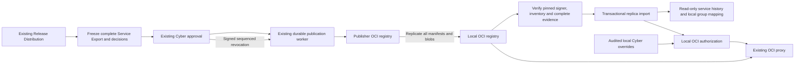

# Portable approved releases

Portable publication extends the existing Release Distributions, Cyber approval, Export All and approved-release worker. A distribution selects deployment artifacts; the frozen review includes the complete service evidence and identifies that selection. The ordinary Service Import workflow continues to import inputs for reassessment. Only a verified, independently trusted approved release can enter the replica evidence path.

## What is signed

The existing `cats-cyber-approved-release-v1` manifest has a `portable` object with format `cats-replica-release-v1`, publisher-scoped service UUID (the existing service key), release UUID (the existing approval ID), positive monotonic service sequence, superseded release UUID, service version, Cyber approval time, expiration, and revocation state. The manifest includes the recorded approver, decision time and rationale, publisher public-key fingerprint, exact image and chart digest inventory, detached evidence signature, and each artifact's immutable Cosign signature manifest digest. Sequence reservation occurs atomically with the Cyber decision. Retries reuse the approved identity and sequence.

`evidence.zip` includes the existing Export All material and `replica-service.json` (`cats-replica-service-v1`). The capture uses Service Export's relational schema, ownership checks and credential redaction while retaining findings, observations, SBOM, mitigations, exceptions, remediation and scan history, approval context, risk assessments and decisions, referenced VEX documents, artifact provenance and the authoritative dashboard outputs. Distribution and proposal evidence include a separately labeled complete service-context Export All archive. Candidate evidence retains its baseline and proposed scope explicitly. Source accounts are retained as identity evidence, never copied as local accounts or permissions. Local paths and credentials are excluded.

An approval created before complete capture support must be submitted for Cyber review again. Publication fails with that instruction instead of reconstructing mutable current evidence for an old decision.

The capture records canonical finding classifications and final eligibility, noncompliance, exception, VEX, KEV and EPSS decisions, plus observation exclusions, at the same capture time. It does not depend on a previously refreshed classification cache. An explicit allowlist retains the source policy configuration; authentication, registry and other runtime configuration are excluded. The replica uses these frozen results for evidence views rather than reassessing them under local policy.



## Registry layout and replication

For destination namespace `cyber-approved` and service key `demo`:

| Repository | Content |
| --- | --- |
| `cyber-approved/demo/<image>` | Images or image indexes, all child manifests and layers, approval tags and Cosign signature artifacts |
| `cyber-approved/demo/charts/<chart>` | Exact Helm package, config and Cosign signature artifacts |
| `cyber-approved/demo/releases` | Portable release documents and standalone signed revocation events |

The portable document artifact has media type `application/vnd.oci.image.manifest.v1+json` and artifact type `application/vnd.cats.approved-release.v1`. Its layers directly reference the signed manifest, signatures, public key, complete evidence archive and candidate archive when applicable. This explicit OCI artifact is the compatibility path: replica verification does not rely on referrer discovery or implicit Harbor attachment behavior. The signed inventory explicitly identifies artifact and signature graphs by digest.

Discovery tags are `release-<20-digit-sequence>-<release-id>` and `revocation-<20-digit-sequence>-<release-id>`. They are published only after the entire graph is verified. Tags are hints; the signed sequence and digest are authoritative. Do not retag existing releases as new approvals.

Replicate the complete service repository subtree, including charts, the `releases` repository, image index children and all Cosign signature artifacts. A filter selecting only image approval tags is insufficient. Harbor documents filtered image/chart replication and associated Cosign signature replication, but also warns about unsupported cross-version combinations; qualify the exact Harbor versions and rule before deployment. [Harbor replication documentation](https://goharbor.io/docs/main/administration/configuring-replication/)

Configure an exact repository such as `cyber-approved/demo/releases`, or `cyber-approved/*` to discover descendant release repositories. Exact repositories use paginated `/tags/list`; wildcard scopes also require the registry's paginated `/v2/_catalog`. If catalog listing is unsupported or unauthorized, configure exact repositories. Pagination follows same-origin, same-endpoint `Link: rel="next"` values and rejects cycles and redirects to another repository. There is no first-page or fixed artifact-count shortcut. [OCI Distribution specification](https://github.com/opencontainers/distribution-spec/blob/main/spec.md)

Default replication preserves repository paths and replaces the registry host. A configured namespace mapping can replace the signed source namespace; every fetch still targets the configured local registry. Registry TLS trust and read credentials are local configuration, independent of the publisher signing trust.

## Verification and revocation

Provision the publisher fingerprint independently. A key embedded in a package never grants its own trust. The replica verifies the detached signed manifest before using its sequence or identities, checks exact evidence digests and signatures, validates archive inventory, retrieves every artifact/index child/config/layer, and verifies each explicitly referenced Cosign signature against the pinned publisher and the signed approval times. Missing, corrupt, untrusted or mismatched content cannot produce a complete verified candidate. Storage limits bound bytes, archive expansion and nesting without silently truncating inventories.

Revoking a portable approval queues a standalone signed event through the same durable worker and `releases` repository. It names the exact target release, next sequence, revoker, timestamp and rationale. It does not modify the original signed approval. Failed revocation publication remains visible and can be retried with its original sequence. The original publisher signing identity and approved destination must remain available to publish the event.

Registry replication may deliver objects out of order. Verification failure leaves the existing valid active release available; later sync can retry once all content arrives. Expiration is never extended by copying, importing or retrying. An expired correctly signed package may be retained as historical evidence; active pull authorization applies expiry, revocation and explicit local override policy independently. A disconnected replica can enforce only revocations it has received and verified. Use scheduled sync and a trusted UTC clock.

## Upgrade and compatibility

`CATS_MODE` defaults to `full`, preserving the existing authoring deployment. Replica mode uses the separate `compose.replica.yaml` deployment and database. Back up the database and retained release storage before upgrading. The existing startup schema initialization adds the publication sequence, replica projection, identity mapping and local override tables; no existing approval is rewritten or assigned a fabricated signed sequence.

Existing Service Export and ordinary Service Import remain available in full mode. Ordinary imports still require local reassessment. Historical approvals and their retained bundles remain reviewable. An unpublished or retried legacy approval lacking `replica-service.json` cannot become a portable release: submit a new Cyber request and review its complete frozen evidence. Existing OCI proxy authorization remains the full-mode path; replica authorization uses verified imported inventory and explicit local mappings. Retain publisher keys, approved destination configuration and signed receipts for retry and revocation. Key rotation requires independently provisioning the new fingerprint before its releases can be accepted.

## Qualifying a Harbor deployment

The automated real-registry check below exercises OCI Distribution registries, not Harbor's replication engine. Qualify the exact source and target Harbor versions and replication adapter separately:

1. Use disposable source and target projects on TLS-protected Harbor instances. Record both Harbor versions, adapter type, certificates, robot scopes, retention rules and whether catalog listing is permitted. Pin the publisher fingerprint independently in the replica.
2. Publish a new approved service containing an image index with at least two architectures, a Helm chart, complete findings/SBOM evidence and signed decisions. Save the published document digest, artifact/signature digests, release identity, sequence and validity dates.
3. Configure a replication rule covering the complete service repository subtree, including `/releases`, `/charts/`, every index child, blobs and signature artifacts. Run it and retain its task logs. Ensure retention and tag filters do not discard document artifacts or signature manifests.
4. Configure the replica against the target registry only. Use exact `/releases` repositories if catalog listing is unavailable, otherwise exercise wildcard discovery and pagination. Map the imported service to a local group and confirm complete evidence and every architecture/chart are available through authorized local routes.
5. Disable access to both source CATS and source Harbor. Repeat discovery, verification, evidence views and authorized local pulls. Compare the retained signed document and evidence digests with step 2. No original host may be needed.
6. In a disposable target copy, omit one child manifest, layer, evidence document or explicitly referenced signature manifest and repeat sync. Each incomplete candidate must fail verification without replacing the valid active release. Test an untrusted publisher and a changed signed sequence as well.
7. Publish and replicate a newer approval, replay the older package, then publish a standalone revocation. Verify monotonic selection, unchanged original expiry, exact target revocation and restart persistence. Repeat with an interrupted replication task and retry after all objects arrive. Retain logs and results as deployment qualification evidence.

If Harbor does not copy the complete explicitly referenced artifact graphs with the selected rule, the rule is not qualified. Use a compatible replication configuration or an OCI copy process that follows every referenced digest; do not relax signature or completeness checks.

## Repeating the real OCI registry check

`portal/tests/portable_registry_integration.py` uses synthetic relational evidence and real HTTPS registries, real Cosign signing/verification, image indexes and Helm packages. It copies immutable signature manifests explicitly while omitting mutable Cosign tags/referrers, then verifies the replica after stopping the publisher. It also rejects an untrusted signer and a deleted architecture child. It does not test Harbor itself or manufacture a production Cyber review.

The following PowerShell example starts only an isolated internal network and disposable containers, without public registry ports. Run from the repository root with Docker available. Build the full publisher and lightweight replica test images, or substitute existing images built from the corresponding Dockerfiles with their pinned Cosign version. The verification phase uses the code baked into the replica image. Use a new workspace and name prefix for each run.

```powershell
$repository = (Get-Location).Path
$testRoot = Join-Path $env:TEMP ('cats-portable-' + [guid]::NewGuid().ToString('N'))
$testPrefix = 'cats-portable-' + [guid]::NewGuid().ToString('N').Substring(0, 10)
$testImage = 'cats-portable-test:local'
$replicaImage = 'cats-portable-replica-test:local'
New-Item -ItemType Directory -Path $testRoot | Out-Null
docker build -t $testImage -f portal/Dockerfile portal
docker build -t $replicaImage -f portal/Dockerfile.replica portal
$mounts = @('--mount', "type=bind,source=$repository,target=/workspace,readonly",
            '--mount', "type=bind,source=$testRoot,target=/verification")
$runner = @('--rm', '--entrypoint', 'python', '-e', 'PYTHONPATH=/workspace/portal',
            '-e', 'PYTHONDONTWRITEBYTECODE=1')
docker run @runner @mounts $testImage /workspace/portal/tests/portable_registry_integration.py tls /verification
docker network create --internal "$testPrefix-network"
try {
    foreach ($side in @('publisher', 'replica')) {
        docker run -d --name "$testPrefix-$side" --network "$testPrefix-network" `
            --network-alias "$side.test" --mount "type=bind,source=$testRoot,target=/verification,readonly" `
            -e REGISTRY_HTTP_ADDR=0.0.0.0:5000 `
            -e REGISTRY_HTTP_TLS_CERTIFICATE=/verification/tls/registry.crt `
            -e REGISTRY_HTTP_TLS_KEY=/verification/tls/registry.key `
            -e REGISTRY_STORAGE_DELETE_ENABLED=true registry:2.8.3
    }
    docker run @runner @mounts --network "$testPrefix-network" $testImage `
        /workspace/portal/tests/portable_registry_integration.py publish /verification
    if ($LASTEXITCODE -ne 0) { throw 'Publication/copy phase failed' }
    docker stop "$testPrefix-publisher"
    docker run --rm --entrypoint python -e PYTHONPATH=/app -e CATS_MODE=replica `
        -e PYTHONDONTWRITEBYTECODE=1 @mounts --network "$testPrefix-network" $replicaImage `
        /workspace/portal/tests/portable_registry_integration.py verify /verification
    if ($LASTEXITCODE -ne 0) { throw 'Replica verification phase failed' }
} finally {
    docker rm -f "$testPrefix-publisher" "$testPrefix-replica"
    docker network rm "$testPrefix-network"
}
```

Each successful phase emits a compact JSON result. The successful implementation check used `registry:2.8.3` and Cosign `v2.6.1`; its final verification ran in the lightweight replica image with `CATS_MODE=replica` and the publisher stopped. It verified both image architectures and one Helm chart, preserved the exact digest on retry, and passed the disconnected-source, immutable-signature fallback, standalone revocation, wrong-key and missing-child checks. This synthetic release test does not validate a real scanned/patched nginx approval workflow or Harbor replication. The temporary workspace contains only synthetic test data and ephemeral signing/TLS keys; retain it for inspection or remove that explicitly named workspace after review.

## Implementation validation

The following checks ran on 2026-11-05. Suites overlap; their counts must not be added together as a unique-test total.

| Check | Observed result |
| --- | --- |
| Publication, portable verification, approval and evidence tests | 142 passed; 52 evidence tests passed again after the final actor-history capture change |
| Replica synchronization/import/API authorization, operating mode, risk views, Service Transfer and release revisions | 183 passed |
| Final proxy, overrides, approved-scan selection, replica routes/import/sync and finding-query regressions | 59 passed |
| Existing OCI, native VEX, classification, posture and simplified-view compatibility tests | 360 passed, 9 skipped; skipped cases are not credited as passing |
| Real PostgreSQL 16 migration and reconciliation tests | 8 passed in isolated disposable schemas |
| Account, role, OIDC and OCI administration regressions | 42 passed |
| Operating-mode boundary tests | 44 passed |
| Focused frontend tests | 61 passed; type checking, lint and production build passed |
| Real TLS OCI registries and Cosign, final verification in the replica image | Passed with the publisher stopped; explicit immutable signatures worked without mutable Cosign tags or referrer discovery |
| Standalone replica Compose deployment and restart | PostgreSQL, portal and proxy healthy; login, sources and trust pins persisted; unauthorized/CSRF/mutation requests denied; disabled sources queued no jobs; no assessment or intelligence workers started |

The PostgreSQL checks cover additive migration over an existing full-deployment schema, repeated migration, evidence foreign-key remapping, replacement of 23 out of 100 images, immutable history, replay/collision rejection, signed revocation, delayed revocation after a newer release, transaction rollback after projection failure, and preservation of frozen finding decisions. Run them with a dedicated test database URL in `CATS_TEST_REPLICA_POSTGRES_URL`, `PYTHONPATH=portal`, and `python -m pytest portal/tests/test_replica_postgres.py -q`. Each case creates and removes its own UUID-named schema; without that environment variable, these eight tests are explicitly skipped.

Replica enforcement tests cover exact release/digest scope, unchanged artifacts shared across releases, superseded/expired/revoked denials, indefinite overrides, explicit acknowledgement for revoked releases, immediate override revocation, required usage auditing, permission boundaries, mutable-tag substitution, cache reauthorization, tampering and incomplete evidence. Current evidence views remain bound to the approved scan even when the captured history contains a newer unapproved scan. Captured risk/classification decisions remain stable after local policy, feeds or time change.

These checks establish implementation behavior and OCI compatibility with the tested Distribution registries. They do not establish compatibility with an untested Harbor version or production replication rule. Before production rollout, complete the Harbor procedure above and the real service acceptance workflow: scan and approve nginx, replicate it, patch and approve a successor, verify old-digest denial, create and revoke a scoped local override, and repeat while the source environment is disconnected. Multiarchitecture payload verification does not qualify deployment of the current amd64 verifier image on an ARM host.
