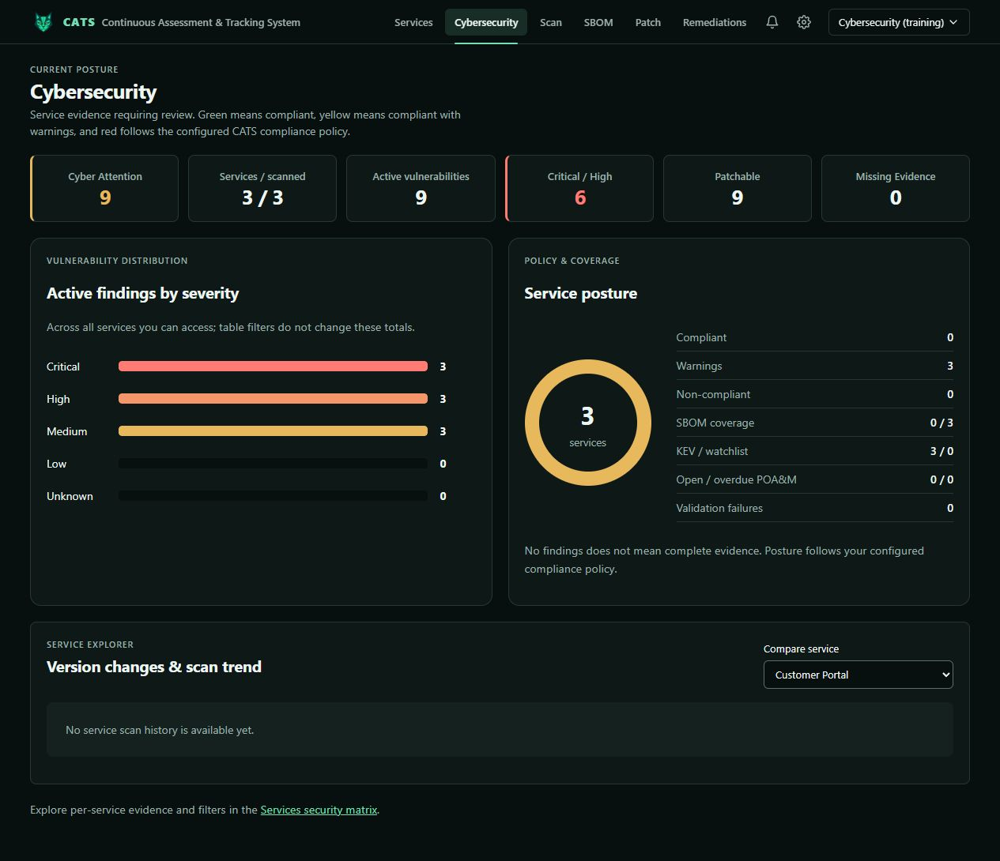
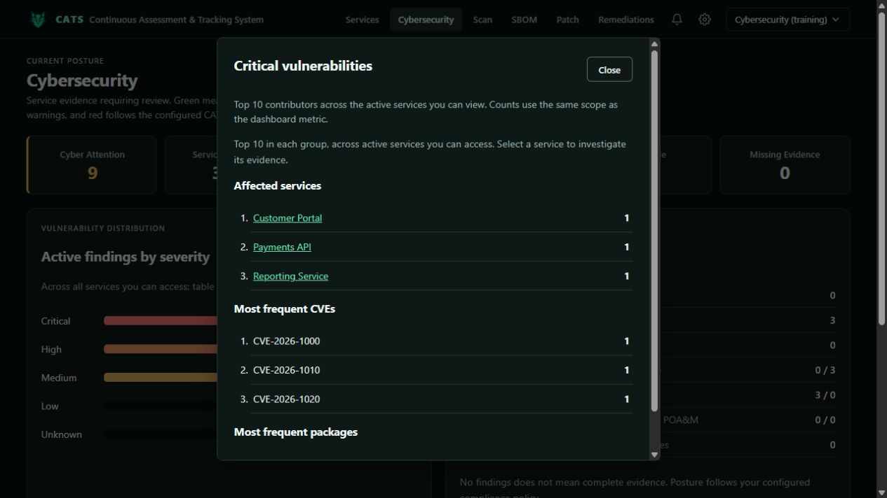
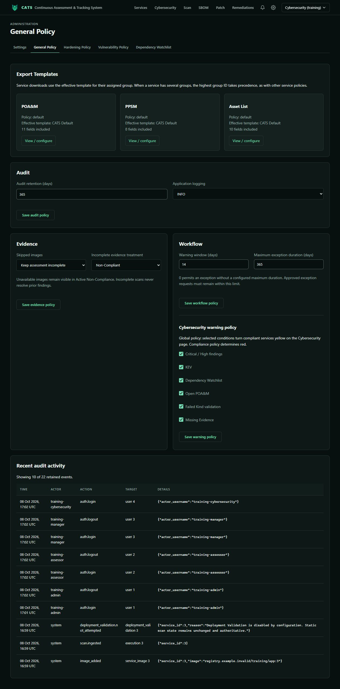

# Cybersecurity training

[Training index](README.md) · [Service workflows](service-manager.md)

Cybersecurity can review/edit scoped services, ingest scans, execute remediation, review governance, remove evidence, restore archived services, view audit records, configure security policy, and manage validators/signing. Cybersecurity can also stage services and manage eligible account role grants within its authorized groups. Global account administration, identity linking, permanent service deletion, and some specialized administrative exports remain administrator responsibilities.

## Investigate dashboard metrics

Open **Cybersecurity**. Review attention, services/scanned, active vulnerabilities, Critical/High, patchable findings, and missing evidence. Dashboard totals cover accessible active services; table filters do not redefine those totals.

Click a metric, severity bar, or supported posture item. **Critical** shows top affected services, frequent CVEs, and packages. Open a contributor and inspect its retained service evidence before assigning work.

Green follows compliance policy; a separate yellow caution triangle marks warnings on an otherwise green compliant service; red follows non-compliance. Hover over the caution indicator to review the warning explanation. Zero vulnerabilities does not establish complete evidence. Review SBOM coverage, KEV/watchlist matches, open/overdue POA&Ms, missing evidence, and validation failures. Use trends/comparison when history exists and the service matrix link for detailed filtering.

## Review independently

Review pending exception, POA&M, and archive requests against evidence, justification, controls, expiry, and scope. Rejecting a request requires a reason. You cannot approve or reject your own request; route it to another authorized reviewer. Revisit active exceptions and revoke when no longer justified. Close active POA&Ms only with supporting evidence. Evidence removal is distinct from permanently deleting a service.

A bulk POA&M, mitigation, or exception import appears as one notification and one request summary. Open it to inspect every imported line, then use that row's **Approve** or **Deny** action. Denial requires a reason. Decisions apply to individual rows, and the summary tracks pending, approved, and denied counts until review is complete. Individually submitted requests retain their separate notifications. The service POA&M view and exports include exceptions and mitigations with their lifecycle states.

## Configure policy

In **General Policy → Workflow**, configure warning timing, exception limits, and **Cybersecurity warning policy**. Available warning conditions include Critical/High, KEV, Dependency Watchlist, open POA&M, failed Kind validation, and missing evidence. Save the intended configuration.

Warning policy does not resolve findings or rewrite compliance decisions. Global configuration requires a global grant; group grants only authorize matching group configuration where supported. Export-template management uses dedicated permissions. Use Vulnerability Policy, Hardening Policy, and Dependency Watchlist for their respective decisions; verify affected service evidence after changes.

For validator, registry, CA, and signing prerequisites, follow the [Administrator configuration guide](administrator.md). Preserve independent host-fingerprint verification and inspect cleanup evidence. Signing requires a usable key, stable server encryption key, and successful verification of the published digest.

## Exercise

Investigate a Critical metric, identify a service/package contributor, and explain warning versus compliance state. Review another user's request and describe how a policy change should be validated against retained evidence.

## Risk Policy and native VEX

Use **Administration → Risk Policy** for profiles and assessment review within your authorized groups. Risk scores support prioritization and do not substitute for Cyber approval. Native VEX exclusion is separately controlled in General Policy and can change actionable findings when enabled. Complete the [Risk Policy and VEX walkthrough](risk-policy-and-vex.md) before changing these policies.

## Onboard accounts within your groups

A signed-in account with no effective permissions sees only: **Contact your cybersecurity POC for access.** Its pending request appears in the notification bell for Cybersecurity users. Open the request to reach **Accounts & Roles**.

Choose **Claim as Assessor**. A single authorized group is preselected; when you cover several groups, select the appropriate one before claiming. Claiming grants Assessor access only to that group, not your own Cybersecurity permissions. The user can refresh their existing session to enter CATS. Once claimed, the request is no longer available to other reviewers.

Use the **Local**, **OIDC**, and **Both** tabs to distinguish sign-in methods. Both means the account has a local password and a linked OIDC identity. Use the role assignment dialog to choose a role and its scope. Cybersecurity can grant only eligible roles within its groups and cannot grant global administration or alter externally managed OIDC grants. Global administrators manage identity linking and account lifecycle actions.
