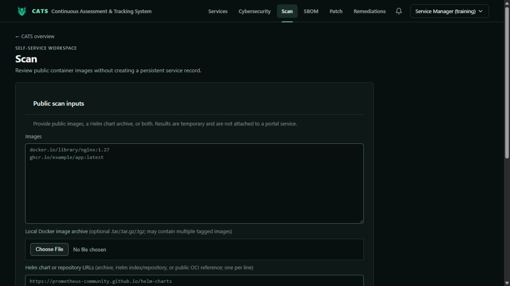
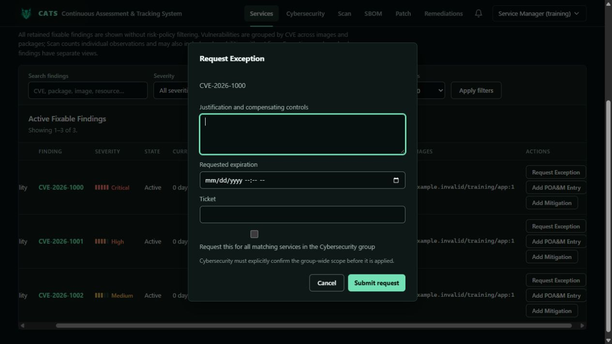

# Service Manager training

[Training index](README.md) · [Evidence review](assessor.md)

Service Managers can view/export and edit assigned services, ingest scans, request exceptions, POA&Ms and archiving, and execute remediation. The built-in role cannot review requests, administer system policy, remove evidence, restore archived services, or permanently delete services.

## Maintain and scan a service

Open an assigned service, select its version, and keep its information, owner, and contact details current. Review retained artifacts and findings before starting work.

On **Scan**, supply supported image references, Docker image archives, Helm inputs, or service-definition YAML. For retained evidence, choose **Ingest completed scan into** and an authorized service/version before running the scan. Inspect skipped inputs and completeness afterward.

The default **Do not ingest (temporary)** creates a public-tool result rather than governed service evidence. Ingestion requires `scan.ingest` and service scope. Private registries and TLS trust need configuration from an authorized administrator. Incomplete scans must not resolve old findings. A service alias can differ from the actual Helm chart package name; chart identity/version must still match its source.

## Request governance decisions

From **Findings**, use **Request Exception**, **Add POA&M Entry**, or the mitigation workflow. Explain justification, affected component, compensating controls, expiry, and tracking reference as applicable.

Check service versus group scope before submission. Group-wide exception requests require explicit confirmation and suitable scope. Configured workflow policy limits expiry. An independent Administrator or Cybersecurity reviewer must decide the request; requesters cannot approve or reject their own requests.

Keep POA&M progress and mitigation evidence current. Closure applies to an active POA&M. Request archiving when a service leaves use; restoration and deletion require other permissions.

The service's **Remediations → POA&Ms** view combines POA&M entries, mitigations, and exceptions, including pending requests and expired or revoked exceptions. Its POA&M export uses the same complete service scope.

To import existing records, select **Import for Cyber review** from the service remediation, POA&M, or exchange view. Choose POA&Ms, Mitigations, or Exceptions, then download the CSV template. Upload a UTF-8 CSV or an Excel workbook with one worksheet and the template's column headings. Exceptions must identify exactly one vulnerability finding ID or policy finding ID belonging to this service and supply a future expiration date. Review the preview, correct any reported errors, and submit. Each row becomes a pending entry; no imported row takes effect as an approval. The import creates one Cyber review request containing all rows. Requests entered individually still create separate notifications.

## Remediate and validate

Remediation must be enabled in administration. Inspect the source-bound plan, use Automated or Guided handling, and resolve ambiguous image mappings explicitly. Confirm registry destination and delivery mode before execution.

Use **Patch** beside an active container image on **Overview** or **Artifacts** to open a patch campaign with that image selected. Scan first if its immutable digest is missing. A successfully verified patch replaces the working inventory image and retains the original image and evidence. Select **✦ Patched** beside the replacement to see the original image, patch date and time, and retained results. Failed or cancelled patches leave the original active. Release adoption still requires the configured assessment and Cyber approval.

Review candidate patch/post-scan evidence, publication, required signature verification, and runtime validation separately. Download-only delivery is not runtime verification. Delivery retries can reuse the remediation revision. Deploy through your organization's process, then scan and ingest authoritative evidence for the deployed version; candidate evidence does not silently replace original governance records.

See [service remediation](../remediation.md) and [pipeline details](../../portal/docs/remediation-pipeline.md).

## Exercise

Select a training ingestion target, draft a justified exception request, and identify the independent reviewer. Explain what evidence is needed after remediation to establish successful deployment.

### Choose assessment scope when ingesting a public scan

Automatic scope treats a scan containing one image and no charts as an image-only update. It preserves other service images and does not promote a different service version. Choose **Full service assessment** only when the submitted inputs cover the entire service; this also supports services consisting of one image. A newer full-service assessment can become current and resolve findings that are absent from the scan. Select the intended Service Version before starting.

If an earlier single-image scan was retained under a historical version, start a new scan of the complete service, choose that version and Full service assessment. Existing scan IDs are immutable and retrying their ingestion does not rewrite their scope. Pipeline clients can submit a new execution ID with `scan_scope: service`; public-job clients can explicitly select `scan_scope=service` on the ingest endpoint before first ingestion. Historical imports and intentional image-only updates remain historical.
